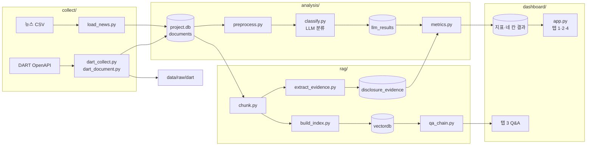

# 프로젝트 파일 구조도

> Day 1 초안. 파일을 추가하거나 이름을 바꾸면 이 문서와 `README.md`를 함께 수정한다.
> 담당: A = 뉴스·전략 분석 / B = 공시·RAG (김민지) / 공동

## 1. 전체 구조

```
beauty-ad-strategy-dashboard/
│
├── README.md                  # [공동·D1] 프로젝트 소개, 실행 순서
├── schema.sql                 # [공동·D1] 뉴스·공시 통합 DB 스키마
├── requirements.txt           # [공동·D1] 설치 패키지 목록
├── .env.example               # [공동·D1] 환경변수 이름만 적은 예시 (값은 비움)
├── .env                       # [각자] 실제 API 키 — 저장소에 올리지 않음
├── .gitignore                 # [공동·D1] .env, data/raw/, DB 파일 제외
│
├── config/
│   ├── settings.py            # [공동·D1] 경로, 수집 기간, DB 위치 등 공통 설정
│   ├── companies.csv          # [B·D1] 분석 대상 8개사 (corp_code, stock_code, is_core)
│   └── themes.yaml            # [A·D1] 전략 테마 7개와 테마별 키워드 사전
│
├── collect/                   # ── 수집·적재 계층 ──
│   ├── load_news.py           # [A·D2] 뉴스 CSV → documents 적재, 중복 제거
│   ├── dart_corp_code.py      # [B·D1] corpCode.xml 내려받기 → 8개사 corp_code 확인
│   ├── dart_collect.py        # [B·D2] 공시 목록(list.json) 수집, 원본 저장, 재실행 가능
│   └── dart_document.py       # [B·D2] 사업보고서 원문 내려받기 → 텍스트 추출
│
├── analysis/                  # ── 분석 계층 ──
│   ├── preprocess.py          # [A·D3] 정규표현식 정제, 관련도 1차 규칙 필터
│   ├── eda.ipynb              # [A·D3] 기사 추이, 급증 시점, 키워드 비중
│   ├── disclosure_eda.ipynb   # [B·D3] 공시 건수 추이, 유형 분포
│   ├── classify.py            # [A·D4] LLM 관련도·테마·감성 분류 → llm_results
│   ├── prompts/
│   │   ├── news_classify_v1.txt     # [A·D4] 뉴스 분류 프롬프트 (버전별 보관)
│   │   └── evidence_extract_v1.txt  # [B·D4] 공시 근거 추출 프롬프트
│   ├── review.py              # [공동·D4] 표본 추출, 검수 결과 → review_samples, 정확도 계산
│   └── metrics.py             # [A·D5] 테마 지표(비중 변화·감성·표본 부족), 네 칸 구분
│
├── rag/                       # ── 공시 검색·질의응답 계층 ──
│   ├── chunk.py               # [B·D3] '사업의 내용' 추출, 청킹
│   ├── build_index.py         # [B·D4] 임베딩 → VectorDB 구축 (메타데이터: 공시명·제출일·링크)
│   ├── extract_evidence.py    # [B·D4] 테마별 근거 문장·근거 수준 → disclosure_evidence
│   ├── qa_chain.py            # [B·D5] LangChain 질의응답, 출처 표시, 근거 없으면 거절
│   └── test_questions.csv     # [B·D5] 테스트 질문 15개와 기대 결과
│
├── dashboard/                 # ── 화면 계층 (저장된 결과만 조회) ──
│   ├── app.py                 # [공동·D6] 진입점: 상단 결론 카드, 공통 필터, 탭 연결
│   ├── data_loader.py         # [공동·D6] DB 조회 함수 (st.cache_data)
│   ├── persona.py             # [A·D6] 페르소나 규칙 계산 (화면에서 계산하는 유일한 로직)
│   └── tabs/
│       ├── tab1_industry.py   # [A·D5~6] 산업 이슈: 추이, 급증, 비중
│       ├── tab2_themes.py     # [A·D5~6] 전략 테마 비교: 뉴스 지표 + 공시 근거, 네 칸 산점도
│       ├── tab3_qa.py         # [B·D6] 공시 Q&A 화면
│       └── tab4_strategy.py   # [공동·D6] A 뷰티 전략 카드, 규제 타임라인
│
├── data/                      # (저장소 제외)
│   ├── raw/
│   │   ├── news/              # 제공 뉴스 CSV 원본
│   │   └── dart/              # DART API 응답 원본 (JSON, ZIP)
│   ├── processed/
│   │   └── project.db         # SQLite DB
│   └── vectordb/              # VectorDB 파일
│
└── docs/
    ├── decisions.md           # [공동·매일] 설계 결정 기록
    ├── PROJECT_STRUCTURE.md   # [공동] 이 문서
    └── report/                # [공동·D7] 리포트, 발표 자료
```

## 2. 데이터 흐름



## 3. 계층 분리 규칙

| 계층 | 하는 일 | 하지 않는 일 |
|---|---|---|
| `collect/` | 외부 데이터를 받아 원본 저장 후 DB에 적재 | 분석, 화면 표시 |
| `analysis/`, `rag/` | LLM 분류, 지표 계산, 임베딩을 **미리** 만들어 저장 | 화면 표시 |
| `dashboard/` | 저장된 결과를 조회해 보여줌 | DART 호출, LLM 분류 |

대시보드에서 예외로 실행되는 것은 두 가지뿐이다.
- `tab3_qa.py`의 RAG 답변 생성 (질문이 들어와야 답할 수 있으므로)
- `persona.py`의 규칙 계산 (LLM·API 호출 없음)

## 4. 담당별 파일 요약

| 담당 | 파일 수 | 주요 파일 |
|---|---|---|
| A (뉴스·전략) | 10 | `load_news.py`, `preprocess.py`, `classify.py`, `metrics.py`, `tab1·tab2` |
| B (공시·RAG, 김민지) | 11 | `dart_collect.py`, `dart_document.py`, `chunk.py`, `build_index.py`, `extract_evidence.py`, `qa_chain.py`, `tab3` |
| 공동 | 9 | `schema.sql`, `settings.py`, `review.py`, `app.py`, `tab4`, `decisions.md` |
