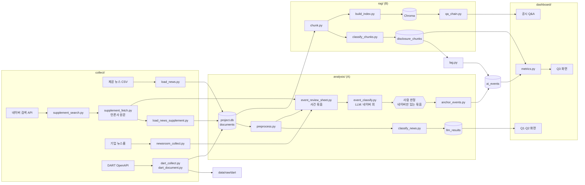

# 프로젝트 파일 구조도

> 기획안 기준 초안. 파일을 추가하거나 이름을 바꾸면 이 문서와 `README.md`를 함께 수정한다.
> 담당: A = 뉴스·이슈 분석 / B = 공시·RAG / 공동

## 1. 전체 구조

```
mid-marketing-insight/
│
├── README.md                  # [공동·D1] 프로젝트 소개, 실행 순서
├── schema.sql                 # [공동·D1] 뉴스·공시 통합 DB 스키마
├── requirements.txt           # [공동·D1] 설치 패키지 목록
├── .env.example               # [공동·D1] 환경변수 이름만 적은 예시 (값은 비움)
├── .env                       # [각자] 실제 API 키 — 저장소에 올리지 않음
├── .gitignore                 # [공동·D1] .env, data/raw/, DB 파일 제외
│
├── config/
│   ├── settings.py            # [공동·D1] 경로, 수집 기간, DB 위치, AI 용어 정규표현식, 요청 규칙
│   ├── companies.csv          # [B·D1] 대상 5개사 (corp_code, stock_code, parent_group, segment, is_control)
│   └── anchor_queries.csv     # [A·D1] 앵커 이벤트 보강 검색어 (기업, 검색어, 목적)
│
├── collect/                   # ── 수집·적재 계층 ──
│   ├── load_news.py           # [A·D2] 제공 뉴스 CSV → documents (news_origin='provided'), 중복 표시
│   ├── supplement_search.py   # [A·D2] 네이버 검색 API → 보강 후보 기사 목록 (원본 JSON 저장)
│   ├── supplement_fetch.py    # [A·D2] robots.txt 확인 → 언론사 원문에서 전문 추출
│   ├── newsroom_collect.py    # [A·D2] 기업 뉴스룸 4곳 보도자료 수집 (회사 "주장"의 1차 출처, 공식 발표일)
│   ├── load_news_supplement.py# [A·D2~4] 보강 기사 CSV → documents (news_origin='supplement')
│   ├── dart_corp_code.py      # [B·D1] corpCode.xml 내려받기 → 5개사 corp_code 확인
│   ├── dart_collect.py        # [B·D2] 공시 목록(list.json) 수집, 원본 저장, 재실행 가능
│   └── dart_document.py       # [B·D2] 정기공시 원문 내려받기 → 텍스트 추출
│
├── analysis/                  # ── 분석 계층 ──
│   ├── preprocess.py          # [A·D3] 정규표현식 정제, 무관 기사 1차 규칙 필터, news_company 매칭
│   ├── eda.ipynb              # [A·D3] 기사량 추이, 급증 시점, 기업별 언급
│   ├── disclosure_eda.ipynb   # [B·D3] 공시 건수 추이, 유형 분포, AI 언급 집계
│   ├── classify_news.py       # [A·D4] LLM 관련도·AI 관련·감성·이슈 키워드 → llm_results
│   ├── event_review_sheet.py  # [A·D3] 제공·네이버·뉴스룸·웹 기사를 사건 묶음으로 → 검토 시트 (규칙 기반, AI 미사용)
│   ├── event_classify.py      # [A·D3] 검토 시트 LLM 1차 판정 (네이버 외 출처 본문만 입력)
│   ├── anchor_events.py       # [A·D4] 확정 이벤트 → ai_events (event_*, search_terms)
│   ├── prompts/
│   │   ├── news_classify_v1.txt     # [A·D4] 뉴스 분류 프롬프트 (버전별 보관)
│   │   └── ai_stage_domain_v1.txt   # [B·D4] 공시 단계·영역 분류 프롬프트
│   ├── review.py              # [공동·D4] 표본 추출, 검수 결과 → review_samples, 정확도 계산
│   ├── lag.py                 # [공동·D5] 첫 공시 반영 → ai_events.first_*, lag_days
│   └── metrics.py             # [공동·D5] AI 언급 밀도, AI 실행률, 평균 반영 시차
│
├── rag/                       # ── 공시 검색·질의응답 계층 ──
│   ├── chunk.py               # [B·D3] 섹션 청킹, AI 용어 집계 → disclosure_chunks
│   ├── classify_chunks.py     # [B·D4] AI 언급 청크만 LLM 단계·영역 분류
│   ├── build_index.py         # [B·D5] 임베딩 → Chroma (메타데이터: chunk_id·공시명·제출일·링크)
│   ├── qa_chain.py            # [B·D5] LangChain 질의응답, 출처 표시, 근거 없으면 거절
│   └── test_questions.csv     # [B·D5] 테스트 질문과 기대 결과
│
├── dashboard/                 # ── 화면 계층 (저장된 결과만 조회) ──
│   ├── app.py                 # [공동·D6] 진입점: 상단 결론 카드, 공통 필터(기간·기업·카테고리)
│   ├── data_loader.py         # [공동·D6] DB 조회 함수 (st.cache_data)
│   └── tabs/
│       ├── q1_issue_trend.py  # [A·D6] Q1 월별 기사량 + 급증 시점
│       ├── q2_sentiment.py    # [A·D6] Q2 기대 vs 우려 비율, 이슈 키워드 Top N
│       ├── q3_disclosure.py   # [B·D6] Q3 단계 분포, 앵커 이벤트 타임라인, 산점도, 기업별 AI 실체 카드
│       └── qa.py              # [B·D6] 공시 Q&A 화면
│
├── data/                      # (저장소 제외)
│   ├── raw/
│   │   ├── news/              # 제공 뉴스 CSV 원본
│   │   ├── news_supplement/   # 앵커 이벤트 보강 기사 (네이버 원본은 약관상 2026-12-04 무렵까지 정리)
│   │   │   ├── naver/         # 검색 API 원본 JSON(raw/), 후보 목록(candidates.csv)
│   │   │   ├── html/          # 언론사 원문 HTML (재실행 시 재사용)
│   │   │   ├── review/        # 이벤트 검토 시트(event_review_sheet.csv), 묶음 구성(cluster_members.csv)
│   │   │   ├── supplement_news.csv   # 전문 추출 결과 (제공 뉴스와 같은 컬럼 + 기업명, fetch_status)
│   │   │   └── anchor_supplement.csv # 수동 확인한 앵커 기사 7건 (수집 코드 검증용 정답지)
│   │   ├── newsroom/          # 기업 뉴스룸 보도자료 (newsroom_news.csv, html/)
│   │   └── dart/              # DART API 응답 원본 (JSON, ZIP)
│   ├── processed/
│   │   ├── project.db         # SQLite DB
│   │   ├── llm_cache/         # LLM 응답 캐시 (프롬프트 버전별)
│   │   └── anchor_events_confirmed.csv  # 확정 앵커 이벤트 (네이버 데이터 미포함)
│   └── vectordb/              # Chroma 파일
│
└── docs/
    ├── AI 마케팅 이슈 × 공시 분석 대시보드 기획안.md
    ├── decisions.md           # [공동·매일] 설계 결정 기록
    ├── PROJECT_STRUCTURE.md   # [공동] 이 문서
    └── report/                # [공동·D7] 리포트, 발표 자료
```

## 2. 데이터 흐름



## 3. 계층 분리 규칙

| 계층 | 하는 일 | 하지 않는 일 |
|---|---|---|
| `collect/` | 외부 데이터를 받아 원본 저장 후 DB에 적재 | 분석, 화면 표시 |
| `analysis/`, `rag/` | LLM 분류, 지표 계산, 임베딩을 **미리** 만들어 저장 | 화면 표시 |
| `dashboard/` | 저장된 결과를 조회해 보여줌 | DART 호출, LLM 분류 |

- 대시보드에서 예외로 실행되는 것은 `qa.py`의 RAG 답변 생성 하나뿐이다. 질문이 들어와야 답할 수 있기 때문이다.
- Q1·Q2 집계는 `news_origin = 'provided'`만 사용한다. 보강 기사는 앵커 이벤트 근거로만 쓴다.

## 4. 담당별 파일 요약

| 담당 | 주요 파일 |
|---|---|
| A (뉴스·이슈 분석) | `anchor_queries.csv`, `load_news.py`, `supplement_search.py`, `supplement_fetch.py`, `newsroom_collect.py`, `load_news_supplement.py`, `preprocess.py`, `eda.ipynb`, `event_review_sheet.py`, `event_classify.py`, `classify_news.py`, `anchor_events.py`, `q1_issue_trend.py`, `q2_sentiment.py` |
| B (공시·RAG) | `companies.csv`, `dart_corp_code.py`, `dart_collect.py`, `dart_document.py`, `disclosure_eda.ipynb`, `chunk.py`, `classify_chunks.py`, `build_index.py`, `qa_chain.py`, `q3_disclosure.py`, `qa.py` |
| 공동 | `schema.sql`, `settings.py`, `review.py`, `lag.py`, `metrics.py`, `app.py`, `data_loader.py`, `decisions.md` |
