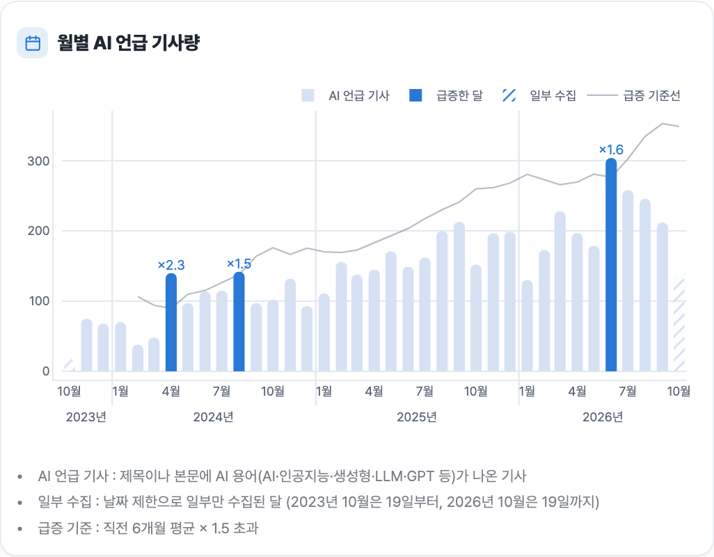
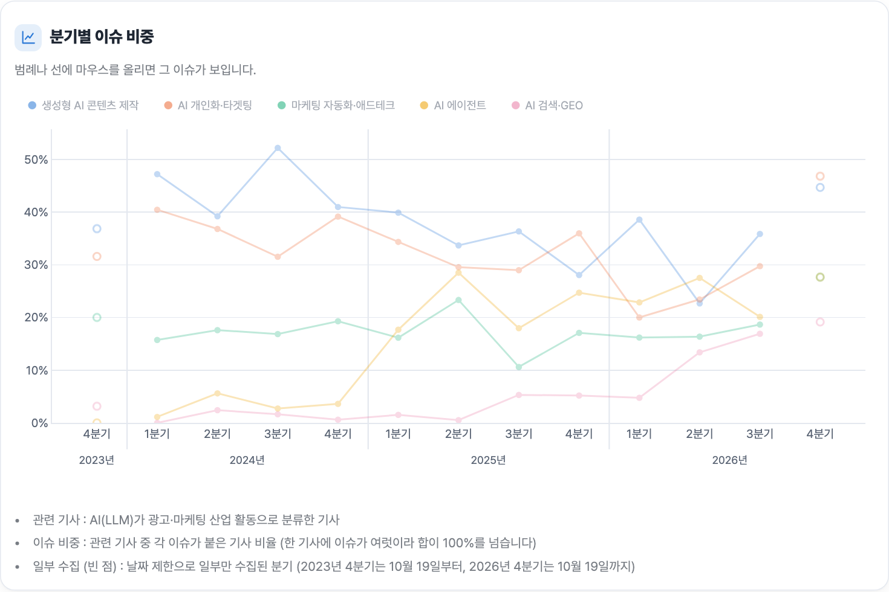
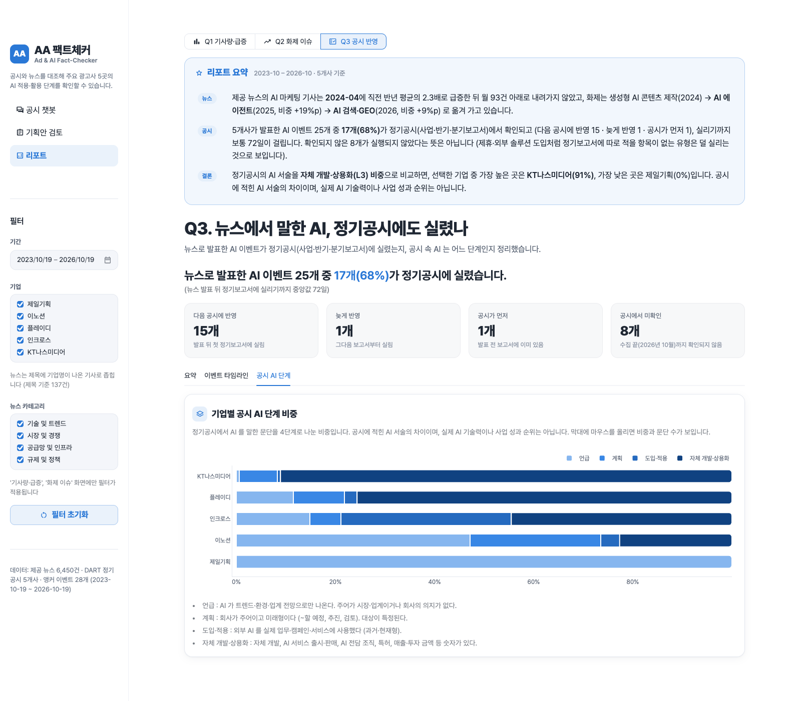
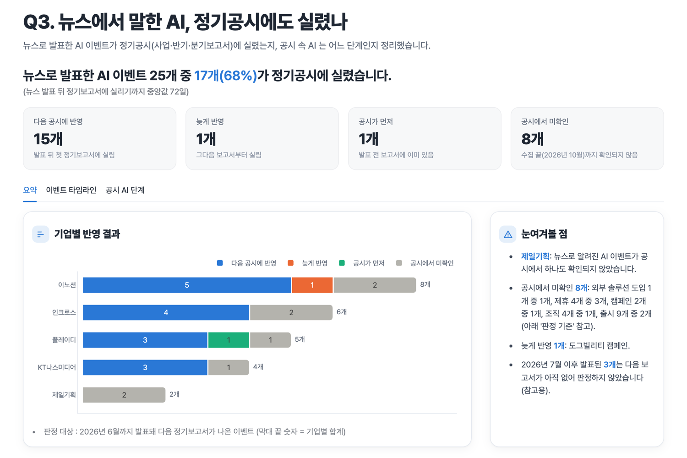
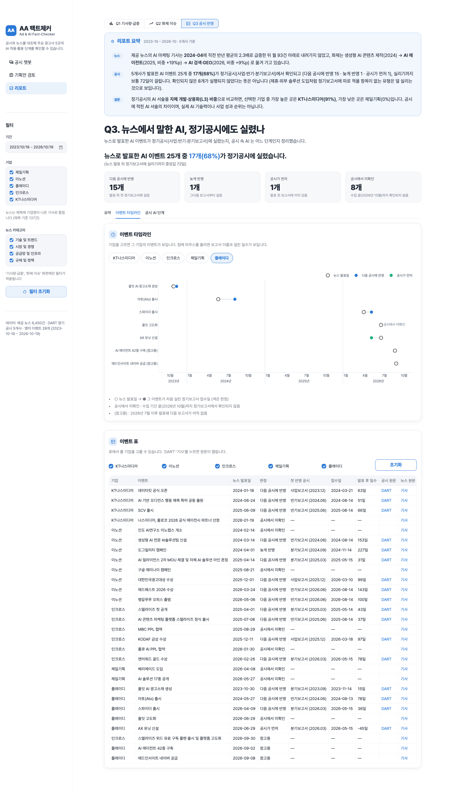
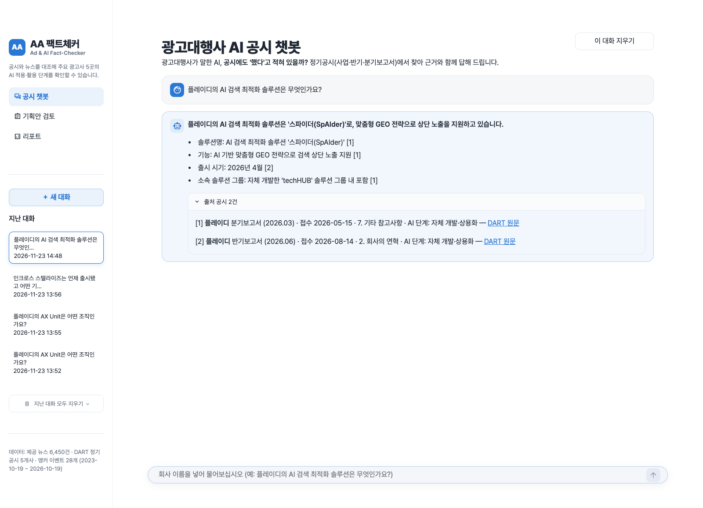
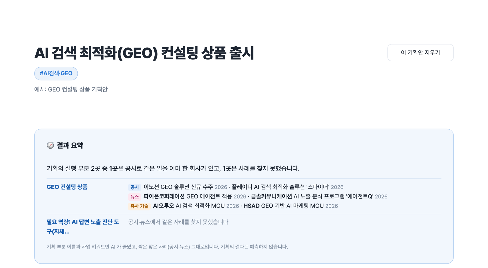

# AI 마케팅 이슈 × 공시 분석 대시보드 — "말뿐인 AI인가, 실행하는 AI인가"

> 중간프로젝트 팀 리포트 (A: 뉴스·이슈 분석 · 대시보드 통합 / B: 공시·RAG). 화면 이름: **AA 팩트체커 (Ad & AI Fact-Checker)**
> 가이드의 리포트 구성(분석 목적 · 데이터 · EDA · AI 기반 이슈 분석 · 공시 Q&A · 대시보드 · 회고) 순서로 썼다. 파트별 상세는 [report_A.md](report_A.md) · [report_B.md](report_B.md), 결정의 이유와 검토한 대안은 [decisions.md](../decisions.md) 에 날짜별로 있다.
> 숫자는 2026-11-20 develop 기준 DB 에서 다시 확인한 값이다.
> 용어: **정기공시** = 사업 · 반기 · 분기보고서. **AI 언급 기사** = 제목이나 정제 본문에 AI 용어가 나온 기사(AI 가 중심인 기사만 뜻하지 않음). **관련 기사** = LLM 이 광고·마케팅 산업 활동으로 분류한 기사. **공시 내 L3 서술 비중** = 공시의 AI 서술(청크) 중 '자체 개발·상용화(L3)'로 분류된 비중(기업의 AI 기술력이나 상용화 수준의 순위가 아님).

---

## 1. 분석 목적

| 항목 | 내용 |
|---|---|
| 산업 | 마케팅 (광고대행·미디어렙) |
| 대상 기업 | 제일기획 · 이노션 · 플레이디 · 인크로스 · KT나스미디어 (5개사) |
| 기간 | 2023-10-19 ~ 2026-10-19 (뉴스·공시 같은 3년) |
| 메인 사용자 | 5개사 밖 **중견 디지털 광고대행사 신사업기획팀장** — "우리 기획과 같은 일을 경쟁사가 실제로 했나?" |
| 서브 사용자 | 브랜드사 광고주 마케팅 담당자 — 대행사 AI 역량 1차 확인 |

**핵심 질문**

| | 질문 | 데이터 |
|---|---|---|
| Q1 | AI 마케팅 언급은 언제 급증했나? | 뉴스 |
| Q2 | 무엇이 화제였고, 어떻게 옮겨 갔나? | 뉴스 + LLM |
| Q3 | 뉴스로 발표한 AI 는 정기공시에도 실렸나? 공시 속 AI 는 어느 단계인가? | 공시 + LLM + 뉴스 이벤트 |

생성형 AI 이후 광고대행사마다 'AI 솔루션' 발표가 이어졌지만, 발표와 실제 사업 활동이 같은지는 뉴스만으로 알 수 없다. 그래서 **뉴스는 발표 근거, 정기공시는 사업 활동을 확인하는 추가 근거**로 나눠 비교한다. 보도자료성 기사로 회사의 발표를 검증하면 순환 논리가 되므로, **정기공시에서 실행 근거가 확인되는지**를 따로 판정한다. 정기공시에 없다고 실행하지 않았다는 뜻은 아니다(4-3).

---

## 2. 데이터

### 2-1. 구성

| 구분 | 범위 | 규모 | 확보 방식 |
|---|---|---|---|
| 제공 뉴스 | 마케팅 키워드 5개 (규제 · AI 마케팅 · 트렌드 · 파트너십 · 인프라) | 6,469건 → 중복 19건 제거 **6,450건** (집계 대상) → 본문이 빈 2건 제외 **6,448건** (LLM 분류 대상) | 과제 제공 |
| 이벤트 보강 기사 | 5개사 AI 이벤트 | 원문 536건 → 확정 이벤트 **28개** | 네이버 검색 API + 언론사 원문 (A) |
| 공시 목록 | 5개사 모든 공시 유형 | **636건** (거래소 331 · 지분 107 · 공정위 93 · 정기 66 · 기타 35 · 주요사항 4) | DART OpenAPI (B) |
| 정기공시 원문 | 사업·반기·분기보고서 | 66건 → 정정 공시는 최신 판만 **60건** → 청크 **2,013개** (AI 용어 포함 459개) | DART OpenAPI (B) |

### 2-2. 수집과 전처리

**뉴스 (A)**
- **중복:** ① 같은 제목 + 같은 본문, ② 같은 매체 + 같은 제목 + 24시간 이내. 다른 매체가 같은 보도자료를 실은 기사는 언론 노출량이라 별개로 센다. 처음 기준(② 7일 이내)으로 잡힌 **24쌍을 사람이 전수 검수**했더니 ② 의 4쌍이 같은 매체가 다른 날 다시 실은 별개 기사여서 기준을 24시간으로 줄였다(사람 판정과 11/12 일치). 바꾼 기준으로 **최종 제거한 것은 19건**(① 13 · ② 6) — 검수 24쌍은 기준을 바꾸기 전 후보라 제거 건수와 다르다.
- **본문 결측 2건:** 제공 데이터의 원문 URL 이 기사가 아니라 네이버 댓글 페이지였다. Q1 기사량에는 넣고, 본문이 필요한 LLM 분류에서는 빼서 분류 대상은 6,448건이다.
- **정제 8종:** 저작권("AI학습 이용 금지")·AI 작성 고지가 AI 용어 오탐을 만들어 지움. 사람 검수 71/71 · 57/57.
- **기업 태그:** 기사↔기업 269행, 사람 검수 268/268. 제목에 나온 기사는 93%가 그 기업이 중심(본문만은 16%) → 기업 필터는 제목 기준(137건).
- **이벤트 보강:** 제공 뉴스는 기업 이벤트 기사가 부족해 따로 수집. 네이버 약관상 **AI 에 넣지 않고 사람만 판정, 원본은 21일 안에 삭제**. LLM 이 '이벤트'로 본 것은 전부 사람이 확인. B 의 질문을 계기로 AI 초안을 원문으로 다시 확인해 30개 → **28개**(판정 25 · 2026-07 이후 참고용 3). 보강 기사는 Q1·Q2 집계에 넣지 않는다.

**공시 (B)**
- `corpCode.xml`(종목코드로 매칭) → `list.json`(유형별 조회) → `document.xml`(ZIP 원본 보존 + 목차 제목 보존). DART 전체 건수와 수집 건수 일치, 중복·기간 밖 0건, 다시 실행해도 DB 동일.
- **청킹 범위:** '사업의 내용 + 회사의 연혁 + 정관'. 나머지 장의 AI 언급은 임원 경력·계열사명 같은 노이즈였다.
- **정정 공시:** 내용은 최신 판, 날짜는 원본 접수일 (정정본 날짜를 쓰면 반영 시차가 부풀어 오름).

**공통 (A·B 합의)**
- **AI 용어 정규표현식** 하나를 뉴스·공시가 같이 쓴다. `AI`·`LLM` 은 앞뒤가 영문자가 아닐 때만 — 그대로 두면 HYUNDAI·THAILAND 에 걸린다(제일기획 2023 사업보고서: 66건 → 실제 3건).
- 기업 표기는 DART 등록명('KT나스미디어'), 연결 키는 `corp_code`.

### 2-3. 통합 스키마 (SQLite, `schema.sql`)

| 테이블·뷰 | 내용 | 만든 사람 |
|---|---|---|
| `documents` | 뉴스·공시 공통 문서 (`source_type` 으로 구분, 문서 번호 뉴스 `N…` · 공시 `D…`) | 공동 |
| `companies` | 5개사 (`corp_code` · 종목코드 · 모그룹) | 공동 |
| `news_company` | 기사 ↔ 기업, 제목 등장 여부 | A |
| `llm_results` | 뉴스 LLM 분류 (관련 · AI 중심 · 감성 · 이슈 · 프롬프트 버전) | A |
| `ai_events` | 뉴스에서 확정한 AI 이벤트 28개 (발표일 · 유형 · 1차 출처 URL · 판정 범위) | A |
| `disclosure_chunks` | 공시 청크 (섹션 경로 · 원본 접수일 · AI 단계 · 근거 · 프롬프트 버전) | B |
| `event_dart_mapping` | 이벤트 ↔ 공시 청크 매칭 후보와 사람 검증 | B |
| `event_reflection` (뷰) | 이벤트별 반영 판정 — 저장하지 않고 매번 계산 | B |
| `review_samples` | 모든 사람 검수 기록 (LLM 판정 · 사람 판정 · 일치 여부) | 공동 |

뉴스와 공시를 한 테이블에 두어 날짜·기업 기준 조회와 RAG 근거 연결을 한 곳에서 처리했다. A 의 `ai_events`(뉴스 발표일)와 B 의 공시 청크가 만나는 지점이 Q3 반영 판정이다.

---

## 3. EDA

### 3-1. 뉴스 — AI 언급 기사는 언제 급증했나 (Q1)

- AI 언급 기사 **5,405건 (집계 대상 6,450건의 84%)**. 수집량이 월 46건 → 339건으로 늘어 전체 평균과 비교하면 후반 달만 급증으로 잡힌다.
- **급증 기준 = 그 달 AI 언급 기사가 직전 6개월 평균의 1.5배 초과.** 첫·마지막 달(일부 수집)은 제외. 1.5배는 판정 가능 32개월 배율의 상위 약 10% 이고, 기간 3·6·12개월 × 배율 1.3·1.5·2.0 의 **9개 조합 모두에서 2024-04 가 급증**이라 결론이 값에 좌우되지 않는다.

| 급증한 달 | AI 언급 기사 | 배율 | 그 달 늘어난 제목 단어 |
|---|---:|---:|---|
| **2024년 04월** | 140건 | ×2.3 | 매출 · 베이글코드 · 흑자 |
| 2024년 08월 | 142건 | ×1.5 | HSAD · 부산국제마케팅광고제 · 개막 |
| 2026년 06월 | 304건 | ×1.6 | 매드업 · 수출 · 코스닥 |



*Q1 화면 — 월별 AI 언급 기사량. 진한 막대가 급증한 달(×배율), 옅은 선이 급증 기준선(직전 6개월 평균 × 1.5), 빗금이 일부만 수집된 첫·마지막 달이다. 2024-04 이후 막대가 기준선 근처에서 내려오지 않는다.*

**배경과 해석:** 2024-04 AI 언급 기사량은 직전 6개월 평균의 2.3배로 증가했고, 이후 월 93건 아래로 내려가지 않았으며 AI 언급 비율도 0.74 이상을 유지했다. 다만 그 달 늘어난 제목 단어가 '매출 · 베이글코드 · 흑자'처럼 **실적 관련 용어**여서, 이 증가를 AI 기술에 대한 관심만으로 생긴 것이라고 단정하기는 어렵다. 'AI 언급 기사'는 AI 용어가 나온 기사 전체라 실적 기사 속 한 줄 언급도 포함되므로, AI 마케팅 활동만 따로 보는 분석은 LLM 이 고른 관련 기사(Q2, 4-1)로 했다. 2024-08(광고제·행사)과 2026-06(애드테크 상장)도 일회성 이유라 타임라인에만 표시했다.

### 3-2. 공시 — 건수 추이와 AI 서술

- 연도별 공시 건수: 2023(10-19부터) 48 · 2024 198 · 2025 216 · 2026(10-19까지) 174. 대부분 거래소·지분 공시이고 AI 사업 서술은 정기공시에 있다.
- 5개사 최신 사업보고서 모두 AI 문장이 있었지만 **성격이 달랐다** — 제일기획은 광고주 캠페인명·시장 전망, 이노션은 선언·계획, 플레이디·인크로스·KT나스미디어는 연구개발 실행 실적. → 언급량만으로는 AI 워싱을 구분할 수 없어 **단계 분류**가 필요하다는 근거가 됐다 (4-2).
- 분기보고서 34건 중 33건은 '회사의 연혁'을 생략한다(공시 서식 규칙) → 반영 판정 규칙에 반영했다 (4-3).

---

## 4. AI 기반 이슈 분석

두 분류 모두 같은 원칙을 따로 찾아냈다: **LLM 은 사실(문장 단위 판단)만 고르고, 최종 결정은 코드가 한다.** 규칙을 프롬프트 문장으로 덧붙일수록 다른 곳이 깨졌기 때문이다.

### 4-1. 뉴스 분류 — 감성 · 이슈 (A)

- 대상 6,448건, 입력 = 제목 + 정제 본문 1,500자, `gpt-4.1-mini` temperature 0, 비용 약 $6.55. 이슈는 **고정 목록 15개** 중 1~3개 (자유 키워드는 표현이 제각각이라 순위를 셀 수 없었다).
- **프롬프트:** v1 은 출시·MOU '발표'를 감성 '기대'로 판정(40/50) → v2 기본값 중립 → v3 예시 보강으로도 '관련 아님' 규칙이 안 지켜짐 → **v4 확정: LLM 은 주체 유형 · 행위 유형 · AI 역할만 고르고 관련 여부는 코드가 정함.**
- **표본 검수:** 개선에 쓴 50건으로는 관련 66 → 90% 였지만 부풀려진 값이라, **새 표본 30건**을 A·B 합의 판정으로 다시 쟀다.

| 항목 | 정확도 (95% 범위) |
|---|---|
| 관련 여부 | **77%** (59~88%) |
| AI 중심 여부 | 77% (59~88%) |
| 감성 | 83% (66~93%) |
| 이슈 (하나 이상 겹침) | **90%** · 정밀도 63% · 재현율 64% |

**결과 (Q2)**
- 관련 기사 **2,492건 (분류 대상 6,448건의 38.6%)**. 감성은 **관련 기사 2,492건 기준** 중립 88.7% · 기대 9.6%(240건) · 우려 1.7%(42건) — 월별 우려 최대 7건이라 처음 기획한 '기대 vs 우려 추이' 차트는 성립하지 않아 만들지 않았다.
- **기대는 쓰지 않는다:** 새 표본에서 LLM 기대 2건은 모두 틀렸고 사람 기대 3건은 모두 놓쳤다.
- **우려는 사람이 다시 걸렀다:** 42건 → 맞음 19 / 아님 23 (LLM 우려 정밀도 45%, 담배 규제·증시 같은 무관 기사가 섞임). 같은 사건을 묶어 화면에 12개.
- **화제 이동:** 생성형 AI 콘텐츠 제작(2024) → **AI 에이전트**(2025) → **AI 검색·GEO**(2026). **비중 = 그 기간 관련 기사 중 그 이슈가 붙은 기사의 비율**(한 기사에 이슈가 1~3개라 합이 100% 를 넘는다). 비교 기준이 두 가지라 나눠 적는다.

| 이슈 | 해마다 비교 (리포트 요약 카드) | 분기 비교 (Q2 화면) | 기사 수 (관련 기사) |
|---|---|---|---|
| 생성형 AI 콘텐츠 제작 | 2024년 비중 **45.2%** (그해 1위) | 2024년 3분기 52% 정점 | 2024년 255건 |
| AI 에이전트 | 2024년 3.4% → 2025년 22.3% (**+19%p**, 그해 가장 많이 오름) | 2024년 1~3분기 평균 3.1% → 2026년 1~3분기 평균 23.5% (+20%p) | 2024년 19건 → 2025년 215건 |
| AI 검색·GEO | 2025년 3.5% → 2026년 13.0% (**+9%p**, 2026년은 10-19까지) | 2025년 3분기 5.3%(13건) → 2026년 3분기 16.9%(58건) | 2025년 34건 → 2026년 113건 |

- '+19%p'·'+9%p' 는 **전년 대비 연간 비중 차이**, '3% → 23%' 는 Q2 화면의 **처음·마지막 세 분기 평균 비교**라 값이 다르다. 관련 기사 전체도 늘었으므로(2024년 564건 → 2025년 964건) 기사 수가 아니라 비중으로 비교한다.



*Q2 화면 — 분기별 이슈 비중. 노랑(AI 에이전트)은 2025년 1분기부터, 분홍(AI 검색·GEO)은 2026년 2분기부터 올라온다. 빈 점은 일부만 수집된 분기다.*

### 4-2. 공시 분류 — AI 단계 (B)

| 단계 | 뜻 | 예 |
|---|---|---|
| 언급 (L0) | 업계 동향·전망, 회사 행동 아님 | "생성형 AI 로 광고 시장이 변화" |
| 계획 (L1) | 추진·MOU·방향 | "AI 전문기업 9곳과 MOU" |
| 도입·적용 (L2) | 외부 AI 사용·다른 회사 AI 운영 대행 | "생성형 AI 기술 도입" |
| 자체 개발·상용화 (L3) | 자사 제품·서비스로 개발·출시, 특허 | "AI 기반 광고 서비스 Ato 오픈" |

- 뉴스·공시가 같은 기준(`config/ai_levels.py`)을 쓴다. **L2 와 L3 의 경계 = "AI 가 들어간 결과물이 누구의 제품인가"** (A·B 합의) — 처음 규칙("불분명하면 L2")대로면 뉴스에서 L3 인 이벤트가 공시에서 L2 가 되어 **가짜 말-실행 격차**가 생겼다.
- AI 용어가 있는 청크 459개를 분류. LLM 은 문장마다 단계만, **청크의 최고 단계는 코드가** 고른다. 프롬프트 v1(시험 20개 중 오류 6) → v6(0) → **v7 확정**.
- **표본 검수 (A·B 합의 판정, 판정 시트에서 LLM 답을 숨김):**

| | 1차 (v6) | 2차 (v7, 처음 보는 표본) |
|---|---|---|
| 표본 일치율 | 38/50 = 76.0% | **23/29 = 79.3%** |
| 전체 비중 가중 정확도 (추정) | 75% | **87%** |

- **전체 비중 가중 정확도:** 표본은 드문 단계를 일부러 더 뽑은 층화 표본이라 표본 일치율이 전체 정확도와 다르다. 그래서 **단계별 정밀도에 전체 AI 청크 459개 중 LLM 이 그 단계로 분류한 비중을 곱해 더한 추정치**를 함께 쓴다. 가중에는 채점한 프롬프트 버전의 분포를 쓴다(1차 v6 결과를 v7 분포로 가중하면 81% 로 부풀어 75% 로 바로잡음, A 리뷰). 다만 검수 표본이 29개로 적어 추정의 불확실성이 크다.
- 단계별 **정밀도**(LLM 이 그 단계라고 한 것 중 사람 판정과 맞은 수)는 **L3 9/9, L2 1/4** 다(재현율은 L3 9/10, L2 1/3). 표본이 작아 L3 를 무조건 믿을 수 있다고 할 수는 없지만, 표본 안에서 L3 는 틀린 적이 없고 L2 는 업계 동향이 섞이는 경우가 많아 **기업 비교에는 공시 내 L3 서술 비중을 쓴다.**
- **특허 기준:** 분류 규칙(v7)은 특허를 L3 에 넣는다(진행 중이어도). '특허 출원·등록만으로는 L3 아님'으로 바꾸면 KT나스미디어 청크 3~4개가 내려가 91.1% → 88.5~89.2% 가 되지만, 다른 4개사와 순서·해석은 같아 다시 분류하지 않고 영향만 기록했다 (report_B 2-1).

**결과 — 기업별 공시 내 L3 서술 비중** = L3(자체 개발·상용화) 청크 수 ÷ L0~L3 로 분류된 청크 수 ('무관'은 분모에서 뺌)

| | KT나스미디어 ¹ | 플레이디 | 인크로스 | 이노션 | 제일기획 |
|---|---:|---:|---:|---:|---:|
| 공시 내 L3 서술 비중 | **91.1%** | 75.6% | 44.5% | 22.6% | **0.0%** |
| L3 / AI 청크(L0~L3) | 143 / 157 | 59 / 78 | 57 / 128 | 12 / 53 | 0 / 12 |

¹ 연결 공시라 자회사였던 플레이디 제품이 들어 있어, 2025-04 매각 전 보고서의 플레이디 제품 청크 13개를 **분자(L3)와 분모(AI 청크) 모두에서** 뺐다 (A·B 합의). 빼기 전에는 156 / 170 = 91.8% 로 순서는 같다.



*Q3 '공시 AI 단계' 화면 — 막대 하나가 그 기업의 공시 AI 문단 전체(100%)이고, 가장 진한 파랑이 자체 개발·상용화(L3)다. 문단 수는 막대에 마우스를 올리면 보인다.*

**해석:** 분석 대상 정기공시에서 AI 관련 서술 중 자체 개발·상용화(L3)가 차지하는 비중은 KT나스미디어가 91.1% 로 가장 높고 제일기획이 0.0% 로 가장 낮았다. 이는 **공시상 AI 사업 서술의 차이**를 보여 주는 결과이며, 기업의 실제 AI 기술력이나 사업 성과 순위로 해석할 수 없다. 차이에는 공시를 쓰는 방식이 크게 작용한다.

- **KT나스미디어** — '연구개발 실적' 표에 과제마다 개발 완료 항목을 나열한다: *"AI 기반 RTB 광고낙찰 솔루션 탑재 : 적정 낙찰가 예측 및 낙찰률 제고를 위한 광고거래 최적화 솔루션 제공"* (반기보고서 2026.06). 이런 표가 분기마다 반복되어 AI 청크가 157개로 가장 많고 대부분 L3 다.
- **제일기획** — AI 가 나오는 문장은 *"디지털광고는 생성형 AI와의 결합을 바탕으로 꾸준한 성장이 전망됩니다"* (반기보고서 2026.06) 같은 **시장 전망(L0)** 이거나, 광고주 캠페인 수상 내역 속 *'BESPOKE AI 냉장고의 비밀'* 처럼 **회사의 AI 가 아닌 이름**(단계 없음)이다. 자사 AI 활동을 연구개발 실적에 적지 않아 L3 가 0개다. 뉴스로 발표한 베리에이드 도입 · AI 솔루션 17종 공개도 공시에서 확인되지 않았다(4-3).
- 즉 비중은 **연구개발 실적 표를 두는지 · 같은 문장을 분기마다 반복하는지 · 연결 자회사 제품이 들어가는지**에 따라 달라진다. 실제 사업 구조의 차이와 공시 작성 방식의 차이를 이 데이터만으로 나눌 수는 없다.

### 4-3. 뉴스 이벤트의 공시 반영 (Q3, A 이벤트 × B 매칭)

- **판정 대상:** 전체 확정 이벤트 28개 중 분석 종료 시점(2026-10-19) 이후에야 다음 정기보고서가 나오는 **참고용 이벤트 3개**(2026-07 이후 발표)를 제외한 **25개를 반영 판정 대상**으로 삼았다.
- **매칭:** B 가 이벤트마다 **공시용 검색어**를 따로 만들었다(뉴스 '아토' ↔ 공시 'Ato 오픈'). 후보 312개(키워드 후보 전부 + 임베딩 후보) → 사람 검증 → 같은 사건으로 확인된 **(이벤트, 공시 청크) 짝 114개**. 같은 문장이 분기마다 반복해 실려 114개 중 **고유 문장은 73개**이고, 짝이 하나 이상 있는 이벤트가 17개다.
- **판정:** 뉴스 발표일 이후 처음 끝나는 분기의 정기공시(기대 보고서)에 실렸나. 분기보고서는 연혁이 없으므로 연혁에만 실리는 이벤트는 반기·사업보고서를 기대 보고서로 본다. 공시는 법정 기한에만 나오므로 주 지표는 일수가 아니라 판정이다.

| 다음 공시에 반영 | 늦게 반영 | 공시가 먼저 | 공시에서 미확인 |
|---:|---:|---:|---:|
| 15 | 1 | 1 | 8 |

- 판정 대상 25개 중 **17개(68%)가 정기공시에서 확인**되었다.
- **실리기까지 걸린 일수** = 뉴스 발표일부터 그 이벤트가 처음 실린 정기보고서의 **접수일**(정정 공시는 원본 접수일)까지. '다음 공시에 반영' 15개 + '늦게 반영' 1개 = **16개 기준 중앙값 72일**(가운데 두 값 66일·78일). 발표 전 보고서에 이미 있던 '공시가 먼저' 1개(-45일)는 시차가 아니라서 뺐다.



*Q3 '요약' 화면 — 판정별 개수와 기업별 반영 결과. 제일기획은 판정 대상 2개가 모두 공시에서 확인되지 않았고, 미확인 8개 중 제휴가 3개다.*

**이벤트 유형별 반영** (판정 대상 25개, 확인 / 전체)

| 수상 | 출시 | 조직 | 특허 | 캠페인 | 제휴 | 외부 솔루션 도입 |
|---:|---:|---:|---:|---:|---:|---:|
| 4/4 | 7/9 | 3/4 | 1/1 | 1/2 | **1/4** | **0/1** |

- 이 분석 대상에서는 **출시·수상은 잘 실리고 제휴는 덜 실렸다.** 정기공시에 적을 자리가 있는지와 관련된 것으로 보인다: 자사 서비스 출시는 '연구개발 실적'·'사업의 내용'에, 수상은 '회사의 연혁'에 적는 관행이 있지만, 금액·계약 조건이 드러나지 않는 MOU·제휴나 외부 솔루션 도입은 마땅히 적을 칸이 없다. 유형마다 표본이 1~9개라 일반적인 법칙이 아니라 **분석 대상에서 관찰된 경향**이다.
- **분석 대상 정기공시에서 확인되지 않은 AI 사업 ≠ 실행하지 않은 사업.** 화면과 결론 문장에 함께 적는다.

### 4-4. 뉴스 화제와 공시 실행 근거 잇기 — AI 검색·GEO 사례

Q2(뉴스의 화제)와 Q3(공시 반영)를 한 사례로 이어 보면:

| 단계 | 확인한 것 |
|---|---|
| ① 뉴스 화제 | 관련 기사 중 AI 검색·GEO 비중이 2025년 3분기 5.3%(13건) → 2026년 2분기 13.4%(36건) → 3분기 16.9%(58건). 2026년에 비중이 가장 많이 오른 이슈(+9%p) |
| ② 기업 발표 | 플레이디가 **2026-04-09** AI 검색 최적화 솔루션 **'스파이더(SpAIder)' 출시** 발표 (앵커 이벤트) |
| ③ 정기공시 | 36일 뒤 접수된 **분기보고서(2026.03, 접수 2026-05-15)** '사업의 내용 > 기타 참고사항': *"AI 검색 환경 변화에 발맞춰 맞춤형 GEO 전략으로 상단 노출을 지원하는 AI 검색 최적화 솔루션 '스파이더(SpAIder)'를 연이어 출시"*. 반기보고서(2026.06) 연혁에도 *"2026년 04월 AI 검색 최적화 전략 컨설팅 솔루션 '스파이더' 출시"* → 판정 **다음 공시에 반영** |
| ④ AI 단계 | 두 문단 모두 **L3 (자체 개발·상용화)** — 자사 솔루션 출시 |
| ⑤ 해석 | 뉴스에서 GEO 가 화제가 되던 시기에, 플레이디는 같은 분야의 자사 솔루션 출시를 정기공시로도 확인할 수 있다. 신사업기획팀장이 GEO 기획을 검토할 때 **공시로 실행 근거가 확인되는 경쟁 사례**가 된다(기획안 검토의 GEO 예시에서도 공시 일치로 이노션·플레이디가 나온다, 6-2). |



*Q3 '이벤트 타임라인' 화면(플레이디) — ○ 뉴스 발표일에서 ● 처음 실린 정기보고서 접수일까지. '스파이더 출시'는 발표 뒤 첫 보고서에 실렸다.*

- 반대로 같은 회사의 **'AI 에이전트 42종 구축'**(2026-09-02)은 다음 정기보고서가 아직 없어 참고용이다. 뉴스 화제(AI 에이전트)가 공시로 확인되기까지는 보고서 주기만큼의 시차가 있다.

### 4-5. 한계

- 뉴스: 키워드 수집 데이터, 새 표본 30건(범위가 넓음), 이슈 정밀도 63%, 기대 감성 미사용.
- 공시: L2 정밀도 1/4, 검수 표본 29개, 공시 내 L3 서술 비중은 공시 서술의 차이(연구개발 실적 표 · 분기별 반복 문장 · 연결 자회사 영향)이지 기술력·성과 순위가 아님, 정기공시에 없는 사업은 확인할 수 없음.
- 두 검수 모두 **합의 판정 기준**이며 사람끼리 일치율은 재지 않았다.

---

## 5. 공시 Q&A (B)

### 5-1. RAG 구성 (`rag/retriever.py`, `rag/qa_chain.py`)

```
질문 ─▶ 하이브리드 검색 (임베딩 text-embedding-3-small + bigram BM25 → RRF, 질문 속 기업 필터, 두 단어 구 일치 가산점) 30개
     ─▶ 본문이 같은 청크 합치기 (가장 이른 보고서) ─▶ 근거 8개
     ─▶ LLM: 근거만으로 JSON 답 (결론 한 줄 + 핵심 줄마다 근거 번호), 근거에 없으면 거절
     ─▶ 출처: 공시명 · 접수일 · 섹션 · AI 단계 · DART 원문 링크
```

- 의미 검색만으로는 정확한 제품명·기업명이 든 근거를 놓쳐 키워드 검색과 섞었다.
- **거절은 LLM 이 근거를 읽고 판단한다.** 답이 있는 질문과 없는 질문의 검색 유사도가 겹쳐(0.30~0.53 vs 0.32~0.55) 경계값으로는 거를 수 없었다.
- LangChain 없이 OpenAI SDK 를 직접 썼다 (검색기를 직접 만들었고 체인이 한 단계).

### 5-2. 평가

| | 개선에 쓴 질문 15개 | **처음 보는 질문 15개 (holdout, 한 번만 실행)** |
|---|---:|---:|
| 검색 (정답 근거 1위, 답이 있는 질문 10개) | 의미 검색만 3/10 → 최종 **10/10** | — |
| 답변 (근거와 함께, 완전 정답) | 10/10 | **8/10** |
| 거절 | 5/5 | **4/5** |

- 검색은 **답이 있는 질문 10개**로만 잰다. 거절해야 하는 질문 5개는 공시에 정답 근거가 없어 '정답 근거를 찾았나'를 잴 수 없다.
- **처음 보는 질문 채점 (사람이 15개 모두 확인):** 답이 있는 10개 = 완전 정답 8 · 부분 정답 1 · 검색 실패 1, 답이 없어야 하는 5개 = 올바른 거절 4 · 환각 1. 위 '8/10' 은 **완전 정답만** 센 값이다(부분 정답 포함 9/10). 개선에 쓴 15개의 10/10 은 새 질문에서의 성능을 보장하지 않는다.
- 처음 보는 질문에서 **환각 1건**: "제일기획이 공개한 AI 솔루션 17종은?" → AI 용어도 '17'도 없는 청크의 도구를 세어 답함. 또 이노션 GEO 문장처럼 긴 청크 속 한 줄은 검색 23위로 밀려 놓쳤다.
- 개발 중 환각("이노션 AI 얼라이언스 몇 개 기업?" → 1차 MOU 10개로 추론, 정답 19개)은 프롬프트 규칙으로는 다시 나타났고, **원인인 검색을 고치자**(정답 청크 22위 → 1위) 사라졌다.

### 5-3. 질의응답 예시와 근거 표시

- 질문 → 굵은 결론 한 줄 + 핵심 목록(줄마다 근거 번호) + 출처 접기(공시명 · 접수일 · 섹션 · AI 단계 · DART 링크).



*공시 챗봇 — 4-4 의 GEO 사례를 물은 답. 근거 번호 [1]·[2]가 아래 출처 공시(분기보고서 '기타 참고사항', 반기보고서 '연혁')와 이어지고, 두 문단의 AI 단계(자체 개발·상용화)도 함께 보인다.*
- 공시에 없는 질문 → "공시에서 확인되지 않습니다".
- 기획안 검토(6-2)의 공시 사례마다 **'구체적인 사례 물어보기'** 말풍선 버튼 → 챗봇 새 대화에서 바로 답한다. 기획안 검토가 찾아 둔 근거 문단도 함께 넘겨, 긴 문단 속 한 줄(이노션 GEO)을 놓치지 않는다.

---

## 6. 대시보드

### 6-1. 화면 구성과 스토리라인

사이드바 메뉴: **공시 챗봇 · 기획안 검토 · 리포트**. 리포트 안에서 맨 위 버튼으로 Q1 · Q2 · Q3 를 고른다.

```
리포트 요약 (결론 먼저: 뉴스 · 공시 · 결론)
   └─ Q1 언제 급증했나 ─▶ Q2 무엇이 화제인가 ─▶ Q3 그 AI 가 공시에도 실렸나
기획안 검토 (메인 사용자: "우리 기획과 같은 일을 누가 했나") ─▶ 공시 챗봇 (사례 더 묻기)
```

| 화면 | 담당 | 내용 |
|---|---|---|
| 리포트 요약 | A·B | 필터로 다시 계산하는 결론 문장 3줄 (`dashboard/conclusion.py`) |
| Q1. AI 마케팅 언급이 급증한 시기 | A | 요약문 · KPI · 월별 AI 언급 기사량(급증 월 · 급증 기준선 · 일부 수집 빗금) · 급증 타임라인 |
| Q2. AI 마케팅 화제 이슈의 변화 | A | 요약문 · KPI · 분기별 이슈 비중 · 이슈 순위 · 도입 전 주의할 점(사람이 거른 우려 기사) |
| Q3. 뉴스에서 말한 AI, 정기공시에도 실렸나 | B | 판정 요약 · 이벤트 타임라인(뉴스 발표일 → 첫 반영 공시) · 공시 AI 단계 비중 |
| 기획안 검토 | A (챗봇 연결 B) | 6-2 |
| 공시 챗봇 (첫 화면) | B | 5장 |

- **공통 필터**(기간 · 기업 · 뉴스 카테고리)는 화면마다 적용 범위가 다르다. **Q1 · Q2 · 요약 '뉴스'** = 셋 다. **Q3 반영 판정 · 요약 '공시'** = 기간(뉴스 발표일 기준) · 기업 — 뉴스 카테고리는 공시에 없어 적용하지 않고 화면에 그렇게 안내한다. **공시 AI 단계 비중 · 요약 '결론'** = 기업만 — 기업의 공시 서술 전체의 성격이라 기간과 관계없이 수집 기간 전체 정기공시로 계산한다. Q1 급증 기준선은 전체 기간으로 계산한 뒤 선택 기간만 잘라 기간을 좁혀도 판정이 바뀌지 않는다. 기업을 고르면 뉴스는 기사가 적어 급증 대신 "그 기업이 언제 무엇으로 보도됐나"를 쓰고, 바로 아래 '공시'(그 기업 이벤트가 공시에 실렸나)와 짝을 이룬다.
- **화면은 저장된 결과만 읽는다** (A·B 합의). 수집·분류·임베딩은 미리 만들고, 예외는 사용자 입력에 답하는 두 곳(챗봇 질문 = 임베딩 1 + LLM 1, 기획안 검토 = LLM 2)뿐이다. 키가 없으면 두 화면만 안내 문구를 내고 Q1·Q2·Q3 는 그대로 동작한다.
- 카드형 UI, 라이트 테마 고정 + 정확한 색, 차트 색은 색약 검증 도구로 확인. 마지막 날 처음 보는 사람 기준으로 문구('-습니다' 말투 · 'AI 언급 기사'), 날짜('2024년 04월'), 범례·설명 위치를 Q1·Q2·Q3 모두 같은 형식으로 통일했다 (A #56~#60 · B #61).

### 6-2. 기획안 검토 (A)

신사업기획팀장이 기획안을 올리면 문단별로 **일치**(같은 일을 이미 한 곳) / **유사**(비슷한 기술을 다른 일에 쓴 곳)를 공시·뉴스에서 찾아 보여 준다.

- LLM 은 검색어 · 문단 번호 · 사업 키워드만 고르고, **일치/유사 판정(조직·제휴·고유 용어)과 결과 요약 문장은 코드가** 만든다. LLM 이 쓴 결론 문장이 공시 사례를 뉴스로 바꿔 쓰는 출처 혼동이 있었기 때문이다. 결과는 예측하지 않는다.
- 처음에는 챗봇 안에 있었으나, 기획안을 올린 대화에서 회사 사실 질문이 모두 '공시에 없음'이 되는 문제를 B 가 찾아 **화면을 분리**했다 (A·B 합의).
- 예: GEO 컨설팅 기획안 → 공시 일치 이노션·플레이디 / 유사 KT나스미디어·인크로스. 정답이 없는 과제라 정확도는 숫자로 재지 않았다.



*기획안 검토 — GEO 컨설팅 기획안의 결과 요약. 기획의 실행 부분마다 공시 일치(같은 일을 이미 한 회사) · 뉴스 · 유사 기술 사례를 나눠 보여 준다.*

### 6-3. 도출한 결론 (리포트 요약 카드, 전체 기간 · 5개사)

| | 요지 |
|---|---|
| 뉴스 | 제공 뉴스의 AI 마케팅 기사는 **2024년 4월** 직전 반년 평균의 2.3배로 급증한 뒤 월 93건 아래로 내려가지 않았고, 화제는 생성형 AI 콘텐츠 제작(2024) → **AI 에이전트**(2025) → **AI 검색·GEO**(2026)로 옮겨 가고 있다 |
| 공시 | 5개사가 발표한 AI 이벤트 25개 중 **17개(68%)** 가 정기공시에서 확인된다 (다음 공시 15 · 늦게 1 · 공시가 먼저 1), 실리기까지 보통 72일. 미확인 8개 중 제휴·외부 솔루션 도입은 공시에 실을 칸이 마땅치 않아, 미확인이 곧 실행 안 함은 아니다 |
| 결론 | 정기공시의 AI 서술을 **자체 개발·상용화(L3) 비중**으로 비교하면, 가장 높은 곳은 **KT나스미디어(91%)**, 가장 낮은 곳은 **제일기획(0%)** 이다. 공시에 적힌 AI 서술의 차이이며, 실제 AI 기술력이나 사업 성과 순위는 아니다 |

**의사결정 관점:** 뉴스의 화제(AI 에이전트 · GEO)는 업계가 무엇을 **발표하는지**를, 공시의 반영 판정과 공시 내 L3 서술 비중은 그중 무엇이 **정기공시에서 실행 근거로 확인되는지**를 보여 준다. 신사업기획팀장은 "AI 에이전트·GEO 가 화제인데, 공시로 실행이 확인되는 경쟁사는 어디인가"를 기획안 검토와 Q3 로 바로 확인할 수 있다. 광고주는 "공시 근거가 없는 AI 솔루션은 도입 전에 따로 확인할 것"으로 읽을 수 있다. 단, 공시 미확인은 실행 부재가 아니며 5개사 사례라 산업 전체로 일반화하지 않는다.

**최종 결론**

분석 결과, AI 마케팅 관련 뉴스는 2024년 4월 크게 증가한 이후 높은 수준을 유지했으며, 주요 화제는 생성형 AI 콘텐츠 제작에서 AI 에이전트와 AI 검색·GEO 로 확대되는 양상을 보였다.

5개사의 AI 발표 이벤트 25개 중 17개(68%)는 정기공시에서도 관련 근거를 확인할 수 있었다. 다만 공시에서 확인되지 않은 이벤트가 실제로 실행되지 않았다는 의미는 아니다.

또한 AI 관련 공시 서술에서 자체 개발·상용화(L3)가 차지하는 비중은 기업별로 차이가 나타났다. 이는 각 기업이 공시에서 설명하는 AI 사업 활동의 차이를 보여 주지만, 기업의 실제 AI 기술력이나 사업 성과를 직접 평가한 결과는 아니다.

따라서 이 대시보드는 뉴스에서 발표된 AI 관련 활동을 정기공시 근거와 교차 확인하고, 신사업기획 담당자가 경쟁사의 유사 사업 사례를 검토할 수 있도록 지원한다.

---

## 7. 회고

### 7-1. LLM 활용 시 발생한 문제와 대응

| 문제 | 어디서 | 대응 |
|---|---|---|
| 규칙을 프롬프트에 덧붙일수록 다른 곳이 깨짐 | 뉴스 '관련 아님'(v3) · 공시 최고 단계(v4) · 기획안 일치/유사 | **판단은 LLM, 결정은 코드** — LLM 은 문장 단위 사실만, 최종 판정·계산은 코드 |
| 고친 표본으로 재면 정확도가 부풀어 오름 | 뉴스 관련 90% → 새 표본 77% · 챗봇 10/10 → 처음 보는 질문 8/10 | 개선용과 평가용을 나누고, 평가용은 결과를 본 뒤 고치지 않음 |
| 층화 표본의 일치율 ≠ 전체 정확도 | 공시 단계 검수 | 단계 비중으로 가중한 정확도를 함께 보고, 가중 분포는 채점한 버전으로 (81% → 75% 로 바로잡음, A 리뷰) |
| 환각 — 근거에 없는 숫자 추론 | 챗봇 (얼라이언스 10개 · AI 솔루션 17종) | 프롬프트보다 **검색을 고쳐** 정답 근거를 앞으로. 남은 1건은 한계로 보고 |
| 출처 혼동 — 공시 사례를 뉴스로 씀 | 기획안 결론 문장 | 결론 문장은 코드가 사례 데이터로 생성, LLM 은 이름 줄이기만 |
| 정확도가 낮은 출력 | 감성 '기대', LLM 우려(정밀도 45%) | 기대는 쓰지 않음, 우려는 사람이 거른 목록만. 화면에 이유 명시 |
| AI 가 만든 초안을 원문 확인 없이 확정 | 앵커 이벤트 23개 | 원문 재확인(30 → 28개), 판정 기록에 '정리: Claude, 확인: A' 구분 |
| 데이터 사용 제한 | 네이버 검색 API 약관 · robots.txt | 네이버 기사는 AI 미사용·사람 판정·21일 내 삭제, 막힌 사이트는 수집 안 함 |

### 7-2. 역할 분담과 협업 방식

| 담당 | 범위 |
|---|---|
| A | 뉴스 적재·정제·중복, EDA·급증 시점, 뉴스 LLM 감성·이슈, 앵커 이벤트, Q1·Q2·기획안 검토 화면, 결론 '뉴스', 대시보드 통합·디자인 |
| B | DART 공시 수집·파싱, 청킹·AI 단계 분류·검수, 이벤트–공시 매칭·반영 판정, 공시 RAG 챗봇·평가, Q3·공시 챗봇 화면, 기획안 → 챗봇 연결, 결론 '공시·결론' |
| 공동 | 스키마, AI 용어·AI 단계 기준, 모든 표본 검수(합의 판정), 결론 문장, 리포트·발표 |

- **Day 1 스키마 합의**로 두 사람이 서로를 기다리지 않고 병행했고, `ai_events`(A) ↔ `event_dart_mapping`(B) 에서 작업이 만났다.
- **결정 기록:** 모든 결정은 날짜 · 이유 · 검토한 대안과 함께 `decisions.md` 에, A·B 합의는 표시했다. 리포트의 숫자와 근거는 모두 이 기록에서 나왔다.
- **서로의 데이터에 대 보기:** B 의 공시 검색어 질문이 A 의 이벤트 재검증(30 → 28개)으로, A 의 리뷰가 B 의 가중 분포 오류 수정으로, B 가 A 의 챗봇 확장을 직접 돌려 찾은 문제가 챗봇·기획안 분리로 이어졌다.
- **PR 운영:** 기능마다 브랜치 → PR(base `develop`) → 리뷰 → 스쿼시 병합. 병합 뒤에는 최신 develop 에서 새 브랜치로 시작해 충돌을 피했다.

### 7-3. 다음에 한다면

- 사람끼리 일치율(두 사람이 따로 판정)을 재서 합의 판정의 신뢰도도 보고한다.
- 챗봇: 'AI …' 질문은 인용 근거에 AI 용어가 있어야 답하기, 긴 청크 분할 — 고친 뒤에는 또 새 질문으로 다시 잰다.
- 기획안 검토도 사람이 정답을 정한 기획안 몇 개로 일치/유사 판정 정확도를 잰다.
