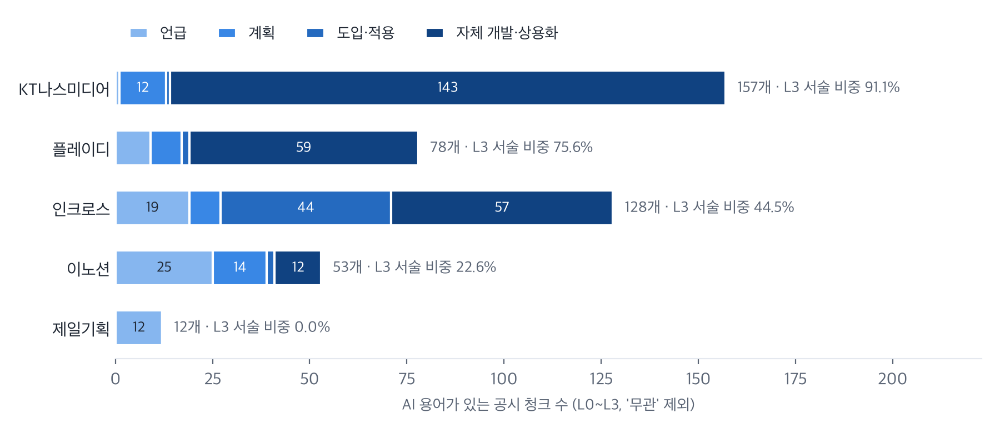
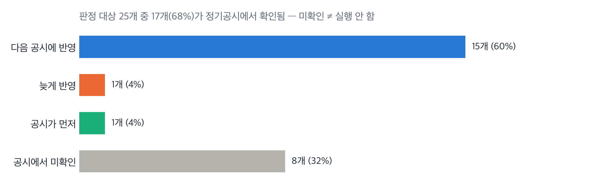
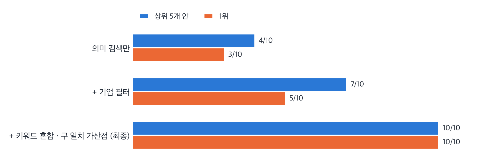

# 리포트 B 파트 — 공시(DART) 데이터 · AI 단계 분류 · 이벤트 반영 판정 · 공시 Q&A

> 프로젝트: AI 마케팅 이슈 × 공시 분석 대시보드 — "말뿐인 AI인가, 실행하는 AI인가"
> 담당: B (공시·RAG). 팀 공동 리포트의 B 파트 원고이며, A 파트(분석 목적·뉴스 데이터·뉴스 LLM 분석·앵커 이벤트)와 합쳐 최종 리포트를 만든다.
> 숫자는 2026-11-20 develop 기준 DB·평가 기록에서 다시 확인한 값이다. 결정의 이유와 검토한 대안은 [decisions.md](../decisions.md) 에 날짜별로 있다.
> 용어: **정기공시** = 사업보고서 · 반기보고서 · 분기보고서. 반영 판정과 단계 분류는 세 종류를 모두 본다.
> **공시 내 L3 서술 비중** = 공시의 AI 서술(청크) 중 '자체 개발·상용화(L3)'로 분류된 비중. 기업의 AI 기술력이나 상용화 수준의 순위가 아니다 (3장).
> **원칙:** '공시에서 미확인'은 '실행하지 않음'이 아니다. 분석 대상 정기공시에서 근거를 찾지 못했다는 뜻이다.

---

## 1. 공시 데이터 수집 및 전처리

### 1-1. 대상과 규모

| 항목 | 값 |
|---|---|
| 대상 기업 | 제일기획 · 이노션 · 플레이디 · 인크로스 · KT나스미디어 (광고대행·미디어렙 5개사) |
| 기간 | 2023-10-19 ~ 2026-10-19 (뉴스와 같은 3년) |
| 공시 목록 | **636건** — 모든 공시 유형 (거래소 331 · 지분 107 · 공정위 93 · 정기 66 · 기타 35 · 주요사항 4). DART 전체 건수와 5개사 모두 일치 |
| 정기공시 원문 | 636건 중 **정기공시 66건**의 원문을 받음 → 정정 공시로 대체된 6건은 최신 판만 써서 **60건 분석** |
| 분석 단위(청크) | 60건을 섹션 단위로 나눈 **2,013개**, 그중 AI 용어가 있는 청크 **459개** |

### 1-2. 수집 과정

```
DART corpCode.xml ─▶ 5개사 고유번호 (종목코드로 매칭)
DART list.json    ─▶ 공시 목록 636건 (공시 유형 A~J 별로 조회해 유형 부여)
DART document.xml ─▶ 정기공시 원문 66건 (ZIP 원본 보존 + 텍스트 추출, 목차 제목 보존)
                  ─▶ SQLite documents ─▶ 섹션 단위 청킹 ─▶ disclosure_chunks
```

- **다시 돌려도 같은 결과:** 이미 받은 원본은 다시 받지 않고, DB 적재는 upsert 로 했다. 다시 실행해도 DB 가 같다는 것을 확인했다.
- **검증:** DART 전체 건수와 수집 건수 일치, 중복·기간 밖·외래키 오류 0건.

### 1-3. 스키마 (B 가 만든 테이블·뷰)

| 테이블·뷰 | 내용 |
|---|---|
| `documents` | 뉴스·공시 공통 문서 표. 공시는 `source_type='disclosure'`, 문서 번호 `D…` (뉴스 `N…` 과 겹치지 않음) |
| `disclosure_chunks` | 공시 청크. 섹션 경로, 원본 접수일(`report_date`), AI 단계(`ai_level`)·영역·근거·프롬프트 버전 |
| `event_dart_mapping` | 뉴스 이벤트 ↔ 공시 청크 매칭 후보와 사람 검증 결과 (`verified`, 검증자, 메모) |
| `event_reflection` (뷰) | 이벤트별 반영 판정 — 저장하지 않고 매칭·분류에서 매번 계산 |
| `review_samples` | 사람 검수 기록 (LLM 판정 · 사람 판정 · 일치 여부 · 메모) |

### 1-4. 수집·전처리에서 정한 것

| 문제 | 확인한 것 | 결정 |
|---|---|---|
| AI 용어 패턴이 영문 회사명을 셈 | `AI` 가 HYUNDAI(758건)·THAILAND(239건) 같은 글자에 걸림. 제일기획 2023 사업보고서: 패턴상 66건 → 실제 3건 | `AI`·`LLM` 은 앞뒤가 영문자가 아닐 때만. 팀 공용 설정으로 뉴스에도 같은 기준 |
| 어느 장을 분석할까 | 5개사의 연구개발은 모두 '사업의 내용' 안에 있었고, '회사의 연혁'에 날짜가 붙은 AI 실행 기록이 있었음. 나머지 장(이사회·임원·계열회사·상세표·첨부)의 AI 언급은 임원 경력·계열사명·감사위원 교육 같은 노이즈 | 사업의 내용 + 회사의 연혁 + 정관만 청킹. **전체 AI 언급 중 포함 비율** = 포함 섹션에 AI 용어가 나온 횟수 ÷ 정기공시 60건 본문 전체에 AI 용어가 나온 횟수 (AI 용어 정규표현식 기준, 청크 수가 아니라 등장 횟수): **플레이디 100%(229/229) · KT나스미디어 97%(583/603) · 이노션 85%(141/165) · 인크로스 84%(350/415) · 제일기획 67%(35/52)** (제일기획 제외분은 이사회·감사위원 교육). Day 2 에 정정 전 판까지 66건으로 처음 셀 때는 인크로스 83% · 제일기획 69% 였고, 표의 값은 분석에 쓰는 60건으로 다시 센 것. 범위 밖 AI 언급 수는 청킹할 때마다 출력 |
| 정정 공시 | 원본과 정정본을 다 쓰면 두 번 세어지고, 정정본 날짜를 쓰면 반영 시차가 늘어남 (KT나스미디어 2025 1분기: 72일) | 내용은 최신 판, 날짜는 **원본 접수일** |
| 분기보고서의 빈 장 | 분기보고서 34건 중 33건이 연혁을 생략 (공시 서식 규칙) | 반영 판정 규칙에 반영 (4-2) |

---

## 2. AI 단계 분류 방법과 검증

### 2-1. 기준

공시 청크에 적힌 회사의 AI 가 어느 단계인지 4단계로 나눴다 (뉴스와 같은 기준, `config/ai_levels.py`). AI 용어가 있지만 회사의 AI 와 관계없는 청크는 '무관'이다.

| 단계 | 뜻 | 예 |
|---|---|---|
| L0 언급 | 업계 동향·전망, 회사 행동이 아님 | "생성형 AI 로 광고 시장이 변화" |
| L1 계획 | 추진·MOU·방향 | "AI 전문기업 9곳과 MOU" |
| L2 도입·적용 | 외부 AI 를 쓰거나 다른 회사 AI 서비스를 운영 대행 | "생성형 AI 기술 도입" |
| L3 자체 개발·상용화 | 자사 제품·서비스의 개발 완료·출시·서비스 제공 (특허 출원·등록도 L3 로 둠 — 아래) | "AI 기반 광고 서비스 Ato 오픈" |

- **L2 와 L3 의 경계 = "AI 가 들어간 결과물이 누구의 제품인가"** (A·B 합의). 외부 모델(ChatGPT 등)을 써도 자사 제품으로 내놓으면 L3. 처음 규칙("불분명하면 L2")대로면 뉴스에서 L3 인 이벤트가 공시에서 L2 가 되어 **가짜 말-실행 격차**가 생겼다.
- 검수하며 정한 원칙: 청크에 적힌 내용만 본다(배경지식 X), '공동 개발'이 중심일 때만 L3, 문장의 중심을 본다.
- 대시보드 화면에는 코드 없이 이름만 보인다: 언급 · 계획 · 도입·적용 · 자체 개발·상용화 (PR #40).
- **특허와 상용화는 다르다.** 특허 출원·등록은 자체 개발의 성과이지 제품 출시·상용화가 아니다. 그런데 프롬프트 v7 은 1차 검수 뒤 '특허 출원·등록은 진행 중이어도 3' 으로 정했다(decisions.md Day 5). 즉 L3 에는 **자체 개발(특허 포함)** 과 **상용화(출시·서비스 제공)** 가 함께 묶여 있다. 실제 분류가 이 기준과 어떻게 맞는지 확인했다:
  - L3 청크 271개 중 '특허'가 나오는 청크는 25개(KT나스미디어 19 · 인크로스 6). **특허만을 근거로 L3 가 된 청크는 0개**이고, 대부분 같은 항목에 '개발완료'가 함께 적혀 있다 (예: *"AI 기반 문맥타기팅 광고 개발(KT와 공동 특허 출원, 특허권 등록 진행 중) … 개발완료"*).
  - 예외: KT나스미디어 *"오디언스 행동 예측 장치 및 방법 … (KT NexR과 공동 특허 출원, 특허권 등록 진행 중) … 진행중"* 은 개발이 끝나지 않은 과제인데 특허 출원 때문에 L3 다 (v7 규칙대로의 결과).
  - **기준을 바꾸면:** '특허 출원·등록만으로는 L3 아님'으로 보고 이런 항목을 L3 에서 빼면 KT나스미디어 청크 3~4개가 내려가 공시 내 L3 서술 비중이 91.1% → 88.5~89.2% 가 된다. 다른 4개사는 그대로이고 순서·해석도 같아, 분류 결과는 다시 돌리지 않고 이 영향만 기록한다. 다음에 분류한다면 특허는 L3 와 따로 표시하는 편이 맞다.

### 2-2. 방법

- AI 용어가 있는 청크 459개를 LLM(`gpt-4.1-mini`)으로 분류했다. 응답은 청크 본문 해시로 캐시해서 다시 돌려도 바뀐 청크만 부른다.
- **구조:** LLM 은 청크 속 AI 문장마다 단계만 매기고, **청크의 최고 단계는 코드가 고른다.** 인용 구절에 AI 용어가 없으면 코드가 버린다.
  - 처음에는 LLM 에게 청크 전체의 단계를 직접 물었다. 규칙을 문장으로 덧붙일수록 다른 곳이 깨졌고(v4: 연혁 청크에서 낮은 항목을 최고 단계로 고름), "판단은 LLM, 계산은 코드"로 나누자 안정됐다 (v6).
- 프롬프트 이력: v1(시험 20개 중 오류 6) → v6(0) → 1차 검수 오류 유형을 규칙으로 → **v7 확정**.

### 2-3. 검증 (사람 검수)

두 차례 모두 같은 표본을 A·B 가 **상의해 한 번 판정(합의 판정)** 하고 LLM 과 비교했다. 판정자가 LLM 답을 보지 않도록 판정 시트에서 숨겼다.

| | 1차 (v6) | 2차 (v7, 확정) |
|---|---|---|
| 표본 | 새 표본 50개 (기업당 10, 시험 20개 제외) | **처음 보는** 표본 29개 (기업당 6, 제일기획은 남은 청크가 5개뿐 · 1차·시험 표본 제외) |
| 표본 일치율 | 38/50 = 76.0% | **23/29 = 79.3%** |
| 전체 비중 가중 정확도 (추정) | **75%** | **87%** |

- **표본을 뽑은 기준 (층화):** 기업마다 같은 수를 뽑되, 그 기업 안에서 **LLM 이 매긴 단계(L0·L1·L2·L3·무관)마다 먼저 하나씩** 뽑고 나머지를 무작위로 채웠다 (1차는 LLM 이 AI 문장을 하나도 못 찾은 청크도 모두 넣음, `rag/level_review_sheet.py`). 드문 단계(L2·무관 등)도 검수하려는 설계라, 표본의 단계 구성이 전체와 다르다.

| LLM 단계 | L0 | L1 | L2 | L3 | 무관 | 계 |
|---|---:|---:|---:|---:|---:|---:|
| 전체 459개 (v7) | 66 (14.4%) | 42 (9.2%) | 49 (10.7%) | 284 (61.9%) | 18 (3.9%) | 459 |
| 2차 표본 (v7) | 7 | 5 | 4 | 9 | 4 | 29 |
| 전체 459개 (v6) | 60 (13.1%) | 41 (8.9%) | 86 (18.7%) | 253 (55.1%) | 19 (4.1%) | 459 |
| 1차 표본 (v6) | 13 | 4 | 6 | 18 | 9 | 50 |

- **가중 정확도 계산식:** 표본 일치율은 드문 단계가 많이 들어간 값이라 전체 정확도가 아니다. 그래서 **LLM 단계별 정밀도 × 전체 459개 중 그 단계의 비중**을 모두 더한 값을 '전체 비중 가중 정확도'로 함께 쓴다.
  - 2차(v7): 0.144 × 7/7 + 0.092 × 3/5 + 0.107 × 1/4 + 0.619 × 9/9 + 0.039 × 3/4 = **87.4%**
  - 1차(v6): 0.131 × 13/13 + 0.089 × 2/4 + 0.187 × 1/6 + 0.551 × 17/18 + 0.041 × 5/9 = **75.0%**
  - 가중에는 **채점한 프롬프트 버전의 분포**를 쓴다 (1차 v6 결과를 v7 분포로 가중하면 81% 로 부풀었음 — A 리뷰로 찾아 고침, PR #23·#25). 두 값 모두 `review_samples` 의 채점 기록으로 다시 계산해 같은 값을 확인했다.
- **87% 는 추정치다.** 459개 전체를 사람이 판정한 정확도가 아니라, 단계마다 4~9개 표본의 정밀도를 전체 비중으로 넓혀 본 값이다. 특히 전체의 62% 인 L3 의 정밀도(9/9)가 결과를 좌우한다 — L3 가 9개 중 8개만 맞았다면 추정치는 약 80% 로 내려간다. 또 기업마다 같은 수를 뽑아 청크가 적은 제일기획이 상대적으로 많이 들어갔고, 1차·시험 표본을 뺀 나머지에서 뽑아 완전한 무작위 표본이 아니다. 이런 설계 때문에 추정치가 한쪽으로 치우칠 수 있다.
- **과적합을 피했다:** 프롬프트를 고칠 때 본 표본으로는 다시 재지 않았다. 1차 50개로 다시 재면 38 → 45개 일치지만 쓰지 않고, 새 표본으로 쟀다.

**2차(v7) 단계별 결과** — 표본이 작아 단계별 값은 참고용이다.

| 단계 | 정밀도 (LLM 이 그 단계라고 한 것 중 맞은 수) | 재현율 (사람이 그 단계라고 한 것 중 LLM 이 맞힌 수) |
|---|---|---|
| L0 | 7/7 | 7/10 |
| L1 | 3/5 | 3/3 |
| **L2** | **1/4** | 1/3 |
| L3 | **9/9** | 9/10 |
| 무관 | 3/4 | 3/3 |

혼동행렬 (행 = LLM, 열 = 사람 합의 판정, 29개)

| LLM \ 사람 | L0 | L1 | L2 | L3 | 무관 | 계 |
|---|---:|---:|---:|---:|---:|---:|
| L0 | 7 | | | | | 7 |
| L1 | 1 | 3 | 1 | | | 5 |
| L2 | 2 | | 1 | 1 | | 4 |
| L3 | | | | 9 | | 9 |
| 무관 | | | 1 | | 3 | 4 |
| 계 | 10 | 3 | 3 | 10 | 3 | 29 |

- 표본 안에서 LLM 이 L3 라고 한 9개는 모두 맞았고, L2 라고 한 4개 중에는 업계 동향(사람 L0) 2개가 섞였다. 표본이 작아 확정할 수는 없지만 **L2 는 틀린 경우가 많고 L3 는 표본에서 안정적이어서** 기업 비교는 L3 서술 비중으로 한다 (3장).
- 사람끼리 일치율은 재지 않았으므로 '합의 판정 기준 정확도'로 표기한다.

---

## 3. 기업별 공시 AI 서술 단계 분석

### 3-1. 공시 내 L3 서술 비중

**공시 내 L3 서술 비중 = L3 청크 수 ÷ L0~L3 로 분류된 청크 수 × 100** ('무관' 청크는 분모에서 뺌)

| 기업 | L0 | L1 | L2 | L3 | L0~L3 합 | **공시 내 L3 서술 비중** | 무관 |
|---|---:|---:|---:|---:|---:|---:|---:|
| KT나스미디어 ¹ | 1 | 12 | 1 | 143 | 157 | **91.1%** | 0 |
| 플레이디 | 9 | 8 | 2 | 59 | 78 | **75.6%** | 0 |
| 인크로스 | 19 | 8 | 44 | 57 | 128 | **44.5%** | 5 |
| 이노션 | 25 | 14 | 2 | 12 | 53 | **22.6%** | 6 |
| 제일기획 | 12 | 0 | 0 | 0 | 12 | **0.0%** | 7 |

¹ KT나스미디어는 연결 공시라 자회사였던 플레이디의 제품(All it·Ato·크레파스 등)이 들어 있다. 같은 AI 가 두 회사에 세어지지 않도록 **2025-04 플레이디 매각 전 보고서의 플레이디 제품 근거 청크 13개를 뺐다** (A·B 합의). 13개는 분자(L3)와 분모(L0~L3 합) **모두에서** 뺐다. 빼기 전에는 L3 156 / 170 = 91.8% 로, 순서와 해석은 같다. 분류 자체는 공시 그대로 둔다.



*기업별 AI 청크 수를 단계별로 쌓은 그래프 (가장 진한 파랑 = 자체 개발·상용화). KT나스미디어는 청크 157개 중 143개가 L3 이고, 제일기획은 12개가 모두 '언급'이다. 막대 길이(청크 수) 자체가 기업마다 크게 달라, 공시에 AI 를 얼마나 길게 적는지부터 차이가 난다.*

**보조 지표 — 같은 문단의 반복을 뺀 비중:** 같은 문단이 분기마다 다시 실리는 효과를 보려고, 글자(공백 제외)까지 같은 청크를 한 번만 세어 다시 계산했다.

| 기업 | 청크 (전체 → 고유) | 공시 내 L3 서술 비중 (전체 → 고유 문단 기준) |
|---|---|---|
| KT나스미디어 | 157 → 142 | 91.1% → 90.1% |
| 플레이디 | 78 → 46 | 75.6% → 78.3% |
| 인크로스 | 128 → 86 | 44.5% → 47.7% |
| 이노션 | 53 → 43 | 22.6% → 20.9% |
| 제일기획 | 12 → 12 | 0.0% → 0.0% |

- 반복을 빼도 순서와 비중은 거의 같다. 다만 분기마다 표에 한두 줄이 더해지는 경우가 많아 글자까지 같은 문단만 빠지므로, **비슷한 문단의 반복까지 걷어 낸 값은 아니다.**
- '고유 AI 제품·서비스 수'도 검토했지만, 제품 이름을 사람이 직접 뽑아 맞춰야 해서 DB 로 검증할 수 없어 넣지 않았다.

### 3-2. 해석

- 공시 분석 결과, **KT나스미디어·플레이디·인크로스는 자체 AI 제품·서비스의 개발·상용화(L3)에 관한 서술이 상대적으로 많이** 확인되었다. 반면 **제일기획은 분석 대상 공시 청크에서 L1 이상으로 분류된 사례가 없었다** — 공시 속 AI 는 시장 전망과 광고주 캠페인명뿐이다.
- 인크로스의 L2 44개는 대부분 모회사 SK텔레콤의 AI 서비스(T deal) 운영 대행이다.
- **해석 범위:** 공시 내 L3 서술 비중이 높다고 해서 실제 AI 기술력이나 상용화 수준이 반드시 높은 것은 아니다. 이는 **공시 문서에 나타난 AI 서술의 차이**이며, 다음 요인의 영향을 크게 받는다.
  - **보고서 작성 방식:** KT나스미디어·플레이디·인크로스는 '연구개발 실적' 표에 과제마다 개발 완료 항목을 나열한다 → L3 청크가 많이 생긴다. 제일기획은 자사 AI 활동을 이런 표에 적지 않고, AI 가 나오는 문장은 *"디지털광고는 생성형 AI와의 결합을 바탕으로 꾸준한 성장이 전망됩니다"* 같은 시장 전망이다.
  - **같은 내용의 반복 기재:** 같은 표·문단이 분기·반기·사업보고서에 거듭 실린다 (위 보조 지표).
  - **연결 자회사:** KT나스미디어처럼 자회사 제품이 함께 실릴 수 있다 (위 ¹).
- 따라서 '5개사 중 몇 위'는 **AI 역량 순위가 아니라 공시 내 L3 서술 비중의 순위**다.

---

## 4. 뉴스 이벤트의 공시 반영 분석 (Q3)

### 4-1. 매칭

- A 가 뉴스에서 확정한 AI 이벤트 28개(판정 대상 25개, 2026-07 이후 발표 3개는 참고용)마다 **공시용 검색어**를 따로 설계했다. 공시는 뉴스와 다른 말을 쓴다 (예: 뉴스 '아토' ↔ 공시 'Ato 오픈', 뉴스 'SCV' ↔ 공시 '유해 영상 차단').
- **후보 312개** = (이벤트, 청크) 짝, 중복 없음. 검색어로 걸린 청크 전부 + 의미 검색 상위 5개.
- 사람 검증 → **맞는 짝 114개, 이벤트 17개**. 같은 문장이 분기마다 반복되므로 114개의 **고유 문장은 73개**다.
- 같은 이벤트의 기준 = 같은 대상 + 같은 사건. 연구개발 표는 '진행 상태' 칸을 읽는다 (진행 중 = 아직 다른 사건, 개발 완료·서비스 제공 중 = 같은 사건).
- 검색어를 만들다가 공시와 맞지 않는 이벤트 2개를 A 에게 질문했고, A 가 이를 계기로 이벤트 23개를 원문으로 다시 확인해 30개 → 28개로 정리했다.

### 4-2. 판정 규칙 (`event_reflection` 뷰)

**기대 보고서** = 뉴스 발표일 이후 **처음 끝나는 분기**(분기 종료일 기준)의 정기공시. 판정은 첫 반영 보고서의 **기간 종료일**로, 일수는 **접수일**로 계산한다.

| 판정 | 뜻 |
|---|---|
| 다음 공시에 반영 | 기대 보고서에 처음 실림 |
| 늦게 반영 (k분기) | 그 뒤 보고서에서 처음 실림 |
| 공시가 먼저 | 발표 전 보고서에 이미 L1 이상으로 실림 |
| 공시에서 미확인 | 수집 기간 끝(2026-10-19)까지 정기공시에서 찾지 못함 |
| 참고용 | 2026-07 이후 발표 — 다음 보고서가 아직 없어 판정하지 않음 |

- 분기보고서에는 연혁이 없으므로, 연혁에만 실리는 이벤트는 반기·사업보고서를 기대 보고서로 본다. 이 규칙을 넣자 3월에 신설한 AI 솔루션팀이 '1분기 늦게 반영'에서 '다음 공시에 반영'으로 바로잡혔다.
- 주 지표는 '일수'가 아니라 판정이다. 공시는 법정 기한에만 나오므로 일수는 회사보다 공시 일정을 잰다 (3월 말 이벤트 ≈ 45일, 4월 초 이벤트 ≈ 135일).

**'공시에서 미확인'과 '아직 판정할 수 없음(참고용)'은 다르다**

| 구분 | 뜻 | 개수 |
|---|---|---:|
| 공시에서 미확인 | 기대 보고서가 수집 기간 안에 나왔는데, 그 보고서와 이후 보고서(2026-10-19 까지)에서 찾지 못함 | 8 |
| 참고용 (아직 판정할 수 없음) | 기대 보고서가 수집 종료일(2026-10-19)까지 나오지 않음 → 판정하지 않고 타임라인·표에만 표시 | 3 |

- **공시 일정과 맞는지 확인:** 참고용 3개는 2026-09-02 · 09-08 · 09-30 에 발표돼 기대 보고서가 3분기 보고서(2026.09)다. 3분기 보고서는 11월 중순에 접수되므로 수집 종료일까지 없다 → 참고용이 맞다. 판정 대상 25개는 모두 2026-06-30 이전 발표로, 기대 보고서(늦어도 반기보고서, 5개사 모두 2026-08-13~14 접수)가 수집 기간 안에 나왔다.
- **미확인이어도 확인 기회의 수가 다르다.** 발표 뒤 수집 기간 안에 나온 정기공시 수:

| 이벤트 (발표일) | 발표 뒤 정기공시 |
|---|---:|
| 이노션 인도 AI연구소 이노랩스 개소 (2024-02-14) | 11 |
| 이노션 구글 제미나이 캠페인 (2025-08-21) | 4 |
| 인크로스 MBC PPL 협력 (2025-08-29) | 4 |
| KT나스미디어 몰로코 공식 에이전시 파트너 선정 (2026-01-19) | 3 |
| 인크로스 롤큐 AI PPL 협약 (2026-01-30) | 3 |
| 제일기획 베리에이드 도입 (2026-04-08) | 2 |
| 제일기획 AI 솔루션 17종 공개 (2026-05-27) | 1 |
| 플레이디 올잇 고도화 (2026-06-29) | 1 |

  2026년 상반기 발표 이벤트는 기회가 1~2번뿐이라, 이후 보고서에서 '늦게 반영'으로 바뀔 수 있다. 미확인은 '수집 기간 안의 정기공시에서 찾지 못했다'는 뜻으로만 읽는다.

### 4-3. 결과

판정 대상 AI 이벤트 25개 중 **17개(68%)가 정기공시에서 확인**되었고, **8개(32%)는 수집 기간 내 공시에서 확인되지 않았다.** 확인된 17개 중 15개는 다음 공시에 반영, 1개는 늦게 반영, 1개는 뉴스 발표보다 먼저 공시에 반영되었다.

| 다음 공시에 반영 | 늦게 반영 | 공시가 먼저 | 공시에서 미확인 |
|---:|---:|---:|---:|
| 15 | 1 | 1 | 8 |

- **실리기까지 걸린 일수:** 다음 공시에 반영·늦게 반영 16개 이벤트 기준 중앙값 **72일** (공시가 먼저 1개, -45일은 뺌).
- 공시가 먼저: 플레이디 'AX Unit 신설'이 뉴스(2026-06-29)보다 1분기 보고서(2026-05-15)에 먼저 실렸다.



*판정 대상 25개 이벤트의 판정. 확인된 17개 중 15개가 발표 뒤 첫 정기보고서에 실렸다. 회색(공시에서 미확인 8개)은 실행하지 않았다는 뜻이 아니다.*

**이벤트 유형별**

| 유형 | 확인 / 전체 |
|---|---|
| 수상 | 4 / 4 |
| 특허 | 1 / 1 |
| 출시 | 7 / 9 |
| 조직 | 3 / 4 |
| 캠페인 | 1 / 2 |
| **제휴** | **1 / 4** |
| **외부 솔루션 도입** | **0 / 1** |

- 유형별로 공시 확인율에 차이가 났다. 수상·특허·출시는 상대적으로 높고, 제휴와 외부 솔루션 도입은 낮다. 정기공시에 적을 자리가 있는지와 관련된 것으로 보인다 — 자사 서비스 출시는 '연구개발 실적'·'사업의 내용'에, 수상은 '회사의 연혁'에 적지만, 금액·계약 조건이 드러나지 않는 MOU·제휴나 외부 솔루션 도입은 적을 칸이 마땅치 않다. 다만 **유형별 표본이 1~9개로 작아 일반적인 법칙이 아니라 분석 대상에서 관찰된 경향**이다.
- **'공시에서 미확인' ≠ 실행 안 함.** 제휴·외부 솔루션 도입은 정기공시에 실을 칸이 마땅치 않다. 화면과 결론 문장에 이 주의를 함께 적는다.

### 4-4. 대시보드에서 읽는 예 — 제일기획

사이드바 '리포트' 메뉴에서 기업 필터를 **제일기획**만 남기고 맨 위 버튼으로 'Q3 공시 반영'을 고르면:
- 맨 위 요약문과 '요약' 탭: "뉴스로 발표한 AI 이벤트 2개 중 **0개(0%)**가 정기공시에 실렸습니다." / '눈여겨볼 점' 카드 "제일기획: 뉴스로 알려진 AI 이벤트가 공시에서 하나도 확인되지 않았습니다." · "공시에서 미확인 2개: 도입 1, 출시 1 — 제휴·도입은 정기보고서에 실을 칸이 마땅치 않습니다."
- '이벤트 타임라인' 탭: 두 이벤트(AI 배너 자동화 솔루션 베리에이드 도입, AI 솔루션 17종 공개) 모두 뉴스 발표일 옆에 '공시에서 미확인'. 아래 이벤트 표에서 두 이벤트의 기사 원문을 바로 열어 볼 수 있다.
- '공시 AI 단계' 탭과 리포트 요약 카드 '결론': 제일기획의 AI 청크 12개는 모두 L0(시장 전망), 공시 내 L3 서술 비중 0% (5개사 중 5위 — **AI 역량 순위가 아니라 공시 내 L3 서술 비중의 순위**).
- **읽는 법:** 제일기획은 뉴스에서 AI 솔루션 관련 활동을 발표했으나, 분석 대상 정기공시에서는 해당 활동과 직접 연결되는 근거를 확인하지 못했다. 따라서 실행 여부를 단정하기보다 추가적인 자료 확인이 필요하다.
  - 두 이벤트 중 베리에이드는 **외부 솔루션 도입**이라 정기공시에 실을 칸이 마땅치 않은 유형이고, AI 솔루션 17종 공개(2026-05-27)는 발표 뒤 나온 정기공시가 **반기보고서 1건뿐**이라 이후 보고서에서 확인될 수도 있다 (4-2).
  - 신사업기획팀장이라면 "제일기획의 AI 솔루션은 아직 정기공시로는 근거를 찾을 수 없으니, 경쟁 사례로 쓰려면 보도자료·제품 자료로 따로 확인할 것"으로, 광고주라면 "도입 전에 공시 밖 자료(레퍼런스·계약 사례)로 확인할 것"으로 읽을 수 있다.

---

## 5. 공시 기반 RAG 챗봇 구현 및 평가

### 5-1. 구조 (`rag/retriever.py`, `rag/qa_chain.py`)

```
질문 ─▶ 하이브리드 검색 (임베딩 + bigram BM25 → RRF, 질문 속 기업 필터, 두 단어 구 일치 가산점) 30개
     ─▶ 본문이 같은 청크 합치기 (가장 이른 보고서) ─▶ 근거 8개
     ─▶ LLM: 근거만으로 JSON 답 (결론 한 줄 + 핵심 줄마다 근거 번호), 근거에 없으면 거절
     ─▶ 출처: 공시명 · 접수일 · 섹션 · AI 단계 · DART 원문 링크
```

- **하이브리드 검색을 고른 이유:** 의미 검색(임베딩)만 쓰면 정확한 제품명·기업명이 든 근거를 놓쳤다. 임베딩 검색과 bigram BM25(한글 2글자 조각 키워드 검색)를 RRF 로 합치고, 질문 속 기업명으로 거르고, 질문의 두 단어 구가 그대로 든 청크에 가산점을 줬다.
- **거절은 LLM 이 근거를 읽고 판단**한다. 답이 있는 질문과 없는 질문의 검색 1위 유사도가 겹쳐서(0.30~0.53 vs 0.32~0.55) 유사도 경계값으로는 거를 수 없었다.
- LangChain 없이 OpenAI SDK 를 직접 썼다. 검색기를 직접 만들었고 체인이 한 단계라 의존성을 늘릴 이유가 없었다.

### 5-2. 평가 ① — 개선에 쓴 질문 15개

챗봇보다 테스트를 먼저 만들었다. 질문 15개 = 답이 있는 질문 10 + **답이 없어야 하는 질문 5** (매칭에서 '미확인'이 나온 이벤트, 대상 밖 기업).

**검색** — 답이 있는 질문 10개에서 정답 근거(그 기업 청크 중 정답 표현이 든 것)를 찾았나. 챗봇이 실제로 쓰는 '30개 찾아 근거 8개'보다 엄격한 기준으로 쟀다.

| 방식 | 상위 5개 안 | 1위 |
|---|---:|---:|
| 의미 검색만 | 4/10 | 3/10 |
| + 기업 필터 | 7/10 | 5/10 |
| + 키워드 혼합 · 구 일치 가산점 (최종) | **10/10** | **10/10** |



*답이 있는 질문 10개에서 정답 근거가 상위 5개 안(파랑)·1위(주황)에 있었는지. 기업 필터로 다른 회사 청크를 거르고, 키워드 검색을 섞어 제품명·기업명이 든 문단을 앞으로 끌어올리자 10/10 이 됐다 (`rag/eval_retrieval.py`, 2026-11-20 다시 돌려 같은 값).*

- 검색은 **답이 있는 질문 10개**로만 잰다. 거절해야 하는 질문 5개는 공시에 정답 근거가 없어 '정답 근거를 찾았나'를 잴 수 없다.

**답변** — 근거가 있는 질문 10개에서 모두 관련 근거를 인용해 답했고(**10/10**), 근거가 없는 질문 5개에서는 모두 답을 거절했다(**5/5**). 답변 형식을 바꾸거나(v2 → v3) 다른 기능이 붙을 때마다 같은 15개로 다시 돌려 점수가 그대로인지 확인했다.

다만 이 15개는 **검색기 개선과 회귀 테스트에 쓴 질문**이다. 이 질문에 맞춰 검색기를 고쳤으므로 **개발용 질문에서 10/10 · 5/5 를 달성했어도 새로운 질문에서 같은 성능이 나온다는 보장은 없다.** 그래서 처음 보는 질문으로 따로 쟀다 (5-3).

### 5-3. 평가 ② — 처음 보는 질문 15개 (holdout)

개선에 쓰지 않은 새 질문 15개(답 있음 10 · 없어야 함 5)를 기존 질문과 주제가 겹치지 않게 만들고, **DB 에서 근거가 있는지·없는지 먼저 확인**한 뒤 **한 번만** 돌렸다. 결과를 보고 질문이나 챗봇을 고치지 않았다 (`rag/test_questions_holdout.csv`).

| | 개선에 쓴 15개 | **처음 보는 15개** |
|---|---:|---:|
| 답변 (근거와 함께, 완전 정답) | 10/10 | **8/10** |
| 거절 | 5/5 | **4/5** |

**채점 기준과 세부 결과 (처음 보는 15개, `data/processed/review/qa_eval_holdout.csv`)** — 자동 채점(인용 근거에 정답 표현이 있나 / 거절했나) 뒤 15개를 모두 사람이 읽어 판정했다. 위 '8/10' 은 **완전 정답만** 센 값이다(부분 정답은 넣지 않음).

| 평가 항목 | 결과 | 해당 질문 |
|---|---:|---|
| 완전 정답 | 8/10 | H01~H07, H09 (자동·사람 모두 맞음) |
| 부분 정답 | 1/10 | H08 플레이디 센스엔 |
| 정답 또는 부분 정답 | 9/10 | |
| 오답 (틀린 내용으로 답함) | 0/10 | |
| 검색 실패 (근거를 못 찾아 거절) | 1/10 | H10 이노션 GEO |
| 올바른 거절 | 4/5 | R01, R03~R05 |
| 환각 (거절해야 할 질문에 답함) | 1/5 | R02 제일기획 AI 솔루션 17종 |

틀리거나 부분만 맞은 3개를 사람이 읽어 원인을 확인했다.

| 질문 | 원인 | 사람 판정 |
|---|---|---|
| 플레이디 센스엔은 어떤 솔루션? | 영어 표기 'SENSE.N' 문단으로 답함 (자동 채점은 한글 '센스엔'만 찾음). 대상(중소형 광고주)은 맞고 'AI 자동화 운영 솔루션'은 빠짐 | 부분 정답 |
| 이노션은 GEO 같은 AI 솔루션을 어떻게 활용? | **검색 실패.** GEO 문장이 긴 '기타 참고사항' 청크 속 한 줄이라 검색 23위 → 근거 8개 밖 → 거절 | 틀림 |
| 제일기획이 공개한 AI 솔루션 17종은? | **환각.** 근거로 든 청크(미디어 분석 도구 목록)에 AI 용어도 '17'도 없는데 도구를 세어 "AI 솔루션 17종"으로 답함 | 틀림 |

- 개발용 질문(10/10 · 5/5)보다 처음 보는 질문(완전 정답 8/10 · 거절 4/5)에서 점수가 낮다. 개발용 점수는 그 질문에 맞춘 효과가 들어 있으므로, 챗봇 성능은 **처음 보는 질문의 결과로 말한다.**
- 처음 보는 질문에서는 **거절해야 할 질문에 답한 사례(환각)가 1건** 있었다. '고유 이름이 근거에 없으면 답하지 않는다'는 규칙이 'AI 솔루션 17종' 같은 일반 명사구에는 걸리지 않았다.
- 개선 후보: ① 질문이 'AI …'를 물으면 인용 근거에 AI 용어가 있어야 답하기(코드 대조), ② 긴 청크 안 한 줄을 찾도록 영문 고유어 일치 가산점 또는 긴 청크 분할. **고친다면 또 다른 새 질문으로 다시 재야 한다.**

### 5-4. 환각 사례와 고친 방법 (개발 중)

- "이노션 AI 얼라이언스에는 몇 개 기업이 참여했나?" → 1차 MOU 연혁("10개 AI 전문 기업과 손잡고")만 보고 **"따라서 10개"라고 추론**했다(정답 19개).
- 프롬프트 규칙(고유 이름이 근거에 없으면 답하지 않기, 추론 금지)만으로는 근거 조합에 따라 다시 나타났다. **원인인 검색을 고치자**(정답 청크 22위 → 1위) 사라졌다.
- 버그: 같은 문장 합치기를 앞 300자로 비교해, 뒤에 항목이 추가된 연혁 청크를 잘못 합쳐 '아이앤서베이'를 놓쳤다 → 본문 전체 비교로 고침.

---

## 6. 대시보드 구현 (B 화면)

사이드바 메뉴는 **공시 챗봇 · 기획안 검토 · 리포트** 세 개이고, 리포트 안에서 맨 위 버튼으로 Q1·Q2·Q3 를 고른다 (메뉴 구성은 A, PR #49).

| 화면 | 내용 (B 부분) |
|---|---|
| 공시 챗봇 (첫 화면) | 질문 → 굵은 결론 + 핵심 목록 + 출처 접기(DART 링크), 공시에 없으면 "공시에서 확인되지 않습니다". 지난 대화 목록·다시 열기 |
| 기획안 검토 → 챗봇 연결 | 기획안 검토(A)의 공시 사례마다 **'구체적인 사례 물어보기'** 말풍선 버튼 (처음 이름 '공시 챗봇에 물어보기', PR #57 에서 바꿈) — 누르면 챗봇 새 대화에서 바로 답함. 기획안 검토가 찾아 둔 근거 문단도 함께 넘겨, 버튼 문구가 달라도 긴 문단 속 한 줄(이노션 GEO)을 놓치지 않음 (PR #46 · #50) |
| 리포트 → Q3 공시 반영 | 탭 3개: 요약(판정 숫자·핵심 문장·기업별 반영 차트) · 이벤트 타임라인(기업별, 뉴스 발표일 → 첫 반영 공시, **바로 아래 이벤트 표**: 기업 체크박스 · DART·기사 원문 링크) · 공시 AI 단계(기업별 단계 비중 차트, 마우스를 올리면 비중·문단 수) |
| 리포트 요약 카드의 '공시'·'결론' | 공통 필터(기업·기간)로 다시 계산하는 문장 (`dashboard/conclusion.py`, PR #35). A 의 '뉴스' 문장과 이어 붙여 카드 하나 (PR #41 · #51) |

- 차트 색은 판정(다음 공시에 반영 파랑 · 공시가 먼저 청록 · 늦게 반영 주황 · 공시에서 미확인 회색)과 단계(파랑 진하기)를 색약 검증 도구로 확인했다.
- **대시보드 API 호출 범위 (A·B 합의, PR #32):** 수집·분류·임베딩은 화면에서 하지 않는다(`rag/build_index.py` 로 미리). 예외는 사용자 입력에 답하는 두 곳 — 챗봇 질문(질문 임베딩 1 + LLM 1)과 기획안 검토(LLM 2). 키가 없으면 두 화면만 안내 문구를 내고 Q1·Q2·Q3 는 그대로 동작한다.

---

## 7. 종합 결론 및 한계

### 7-1. 결론 (B 파트)

뉴스에서 발표된 AI 관련 활동이 모두 정기공시에서 확인되는 것은 아니었다. 판정 대상 이벤트 25개 중 **17개(68%)가 확인**되었고 **8개(32%)는 확인되지 않았다.** 기업별 L3(자체 개발·상용화) 서술 비중에도 큰 차이가 있었으며(KT나스미디어 91% ~ 제일기획 0%), 이벤트 유형별 공시 확인율도 달랐다(수상·출시는 높고 제휴·도입은 낮음).

따라서 뉴스 발표만으로 AI 실행 수준을 판단하기보다, **정기공시에서 확인되는 개발·상용화 근거를 함께 검토**할 필요가 있다. 단, 공시 미확인은 실행 부재를 의미하지 않는다.

**발견한 것과 의미**

본 분석에서 확인된 핵심은 AI 관련 뉴스 발표와 정기공시의 관계가 기업과 이벤트 유형에 따라 다르게 나타난다는 점이다. 25개 이벤트 중 17개는 공시에서 확인되었으나, 제휴와 외부 솔루션 도입처럼 정기공시에 기록되기 어려운 유형도 존재했다. 따라서 공시 확인율만으로 기업의 AI 실행 수준을 평가하기보다는, 뉴스가 보여주는 활동의 시의성과 공시가 제공하는 사업 근거를 상호 보완적으로 활용해야 한다.

또한 기업별 L3 서술 비중의 차이는 실제 기술력의 차이뿐 아니라 보고서 작성 방식과 반복 기재의 영향을 받을 수 있다. 본 프로젝트는 이러한 한계를 명시하면서 뉴스 이벤트와 공시 근거를 연결해, 사용자가 AI 관련 발표의 근거를 직접 검토할 수 있도록 했다는 데 의의가 있다.

**실무에서 쓰는 법**

- **신사업기획팀장:** 경쟁사의 AI 발표를 볼 때 Q3 에서 '다음 공시에 반영'이면 회사가 법적 책임을 지는 보고서에도 적은 사업으로, '공시에서 미확인'이면 보도자료·제품 자료로 따로 확인할 대상으로 나눠 본다. 기획안 검토로 비슷한 사례를 찾고, 공시 사례는 챗봇에 출처(DART 원문)와 함께 다시 물어 근거 문장을 확인한다.
- **광고주:** 대행사가 제안한 AI 솔루션이 공시에도 자체 개발·상용화(L3)로 적혀 있는지 확인하는 1차 점검으로 쓴다. 공시에 없다고 탈락시키지 않고, 추가로 확인할 질문 목록으로 쓴다.
- **한계를 같이 읽기:** 공시 내 L3 서술 비중은 공시를 쓰는 방식의 영향을 받으므로 순위표로 쓰지 않는다. 단계 분류 정확도(87%)는 표본 29개로 낸 추정치다.

### 7-2. 한계

- 5개사 사례 분석이라 산업 전체로 일반화하지 않는다. 이벤트 유형별 표본은 1~9개다.
- 공시는 수집 기간 끝(2026-10-19)까지라, 2026-07 이후 이벤트 3개는 판정하지 않았다(참고용).
- 단계 분류: L2(외부 AI 도입) 정밀도가 1/4 로 낮다 → 기업 비교는 L3 서술 비중 중심. 검수 표본(29개)이 작고, 합의 판정 기준이며 사람끼리 일치율은 재지 않았다. 가중 정확도 87% 는 층화 표본으로 낸 추정치라 표본 설계에 따라 치우칠 수 있다 (2-3).
- L3 에는 특허 출원·등록(자체 개발)과 출시·서비스 제공(상용화)이 함께 묶여 있다. 특허를 빼면 KT나스미디어만 91.1% → 약 89% 로 바뀐다 (2-1).
- 공시 내 L3 서술 비중은 공시 서술의 차이이며, 같은 문장의 분기별 반복과 보고서 작성 방식의 영향을 받는다. 글자까지 같은 반복만 뺀 보조 지표로 확인했고, 비슷한 문단의 반복은 걷어 내지 못했다.
- 2026년 상반기에 발표된 미확인 이벤트는 확인할 정기공시가 1~2건뿐이었다 (4-2).
- 매칭: 공시에 이름 없이 일반 표현으로만 나오면 찾기 어렵다. 못 찾으면 '미반영'이 아니라 '공시에서 미확인'으로 표기한다.
- 챗봇: 처음 보는 질문에서 완전 정답 8/10 · 부분 정답 1/10 · 검색 실패 1/10, 거절 4/5 · 환각 1/5. 긴 청크 속 한 줄은 놓칠 수 있다.

---

## 부록. 회고 메모 (공동 회고용, B 관점)

- **판단은 LLM, 계산은 코드:** 분류 프롬프트에 규칙을 계속 덧붙이면 다른 데서 깨졌다. 문장마다 단계만 받고 최고 단계는 코드가 고르자 안정됐다. 챗봇 답변 형식도 같은 원리로 내용(LLM)과 모양(코드)을 나눴다.
- **숫자가 무엇을 재는지부터:** 층화 표본의 가중, 고칠 때 본 표본으로 다시 재지 않기, 가중 분포의 버전 맞추기(81% → 75%), 개선에 쓴 질문과 처음 보는 질문을 나눠 재기(10/10 → 8/10). 정확도 숫자 하나가 바뀌는 경위를 결정 기록에 모두 남겼다.
- **빼기 전에 원인부터:** 본문이 빈 기사 2건, 자회사 중복, 반영 판정의 '1분기 늦음' — 모두 원인을 찾자 빼지 않고 규칙으로 해결됐다.
- **서로의 데이터에 대 보기:** 공시 검색어를 만들다 던진 질문이 뉴스 이벤트 23개 재검증으로 이어졌고, A 의 리뷰가 층화 가중·'공시가 먼저' 단계 조건·가중 분포 오류를 찾았다. B 는 A 의 챗봇 확장(PR #29)을 직접 돌려 기획안 대화에서 공시 답이 빠지는 문제를 찾았고, 결과적으로 챗봇과 기획안 검토를 분리했다.
- **협업 운영:** 모든 결정은 날짜·이유·대안과 함께 `decisions.md` 에, A·B 합의는 표시. 스쿼시 병합 뒤에는 최신 develop 에서 새 브랜치로 시작해 충돌을 피했다.
